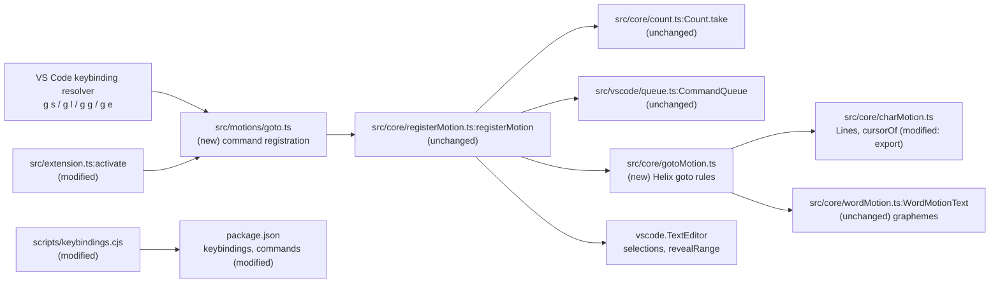

# Goto Motions Specification

## Intent and Delivery Scope

- **Intent:** Supplied in conversation through `/quickie`. Quotation:

  > I need to add some motions:
  > - gs, gl
  > - gg, ge

- **Outcome:** In NORMAL mode, the `g s`, `g l`, `g g`, and `g e` chords move the selections as the Helix 25.07.1 commands with the same keys do.
- **Includes:**
  - `gs` (Helix `goto_first_nonwhitespace`): go to the first character of the line that is not whitespace.
  - `gl` (Helix `goto_line_end`): go to the last character of the line.
  - `gg` (Helix `goto_file_start`): go to the start of the file, or to line `<n>` with a count.
  - `ge` (Helix `goto_last_line`): go to the start of the last line.
  - Count, multiple-selection, read-only editor, and scroll behavior for the four chords.
  - Command contributions, generated keybindings, and README documentation.
- **Constraints:**
  - The Helix reference is version 25.07.1. Source: repository precedent (`test/unit/helixMovement.test.ts`, `test/unit/charMotionCases.ts`) and the locally installed `hx` (`helix 25.07.1 (ba5b022c)`).
  - `package.json` keybindings come from `scripts/keybindings.cjs`. `npm test` fails when they differ. Source: `package.json` script `check:keybindings`.
  - Every bound motion command is contributed in `package.json` and registered in a known source file. Source: `test/unit/keybindings.test.ts` test "every bound motion and edit command is contributed and registered".
  - The README documents every binding. It now states "There are deliberately **no** bindings for `gs`, `gl`, or `%`." The user request replaces that statement for `gs` and `gl`. Source: `README.md` section "What this version does", user request.
  - The integration test profile and the README example use `g l` as a user-defined chord. `test/runIntegration.ts` writes a user binding `g l` → `cursorEnd`, and `test/integration/index.ts` checks it in "user-defined g l overrides blockers and uses native VS Code chords". `README.md` section "Add your first motion, without changing the extension" shows the same binding. User bindings override extension bindings, so these examples must move to a chord that stays unbound. Source: repository files named here.
  - No custom jump history. Source: `README.md` ("No language server, parser, custom buffer, custom jump history, or global `type` override is installed.").
  - The extension has no Helix select mode. Source: `src/core/mode.ts:Mode` is `'normal' | 'insert'`.

### Helix reference behavior

Research date: 2026-10-25. Sources (primary, tag `25.07.1`):

- <https://raw.githubusercontent.com/helix-editor/helix/25.07.1/helix-term/src/keymap/default.rs> — `"g" => goto_file_start`, `"e" => goto_last_line`, `"l" => goto_line_end`, `"s" => goto_first_nonwhitespace`.
- <https://raw.githubusercontent.com/helix-editor/helix/25.07.1/helix-term/src/commands.rs> — `goto_first_nonwhitespace_impl`, `goto_line_end_impl`, `goto_file_start_impl`, `goto_line_impl`, `goto_line_without_jumplist`, `goto_last_line_impl`.
- <https://raw.githubusercontent.com/helix-editor/helix/25.07.1/helix-stdx/src/rope.rs> — `first_non_whitespace_char` uses Rust `char::is_whitespace`.
- <https://raw.githubusercontent.com/helix-editor/helix/25.07.1/helix-core/src/line_ending.rs> — `line_end_char_index` excludes the line break.
- <https://raw.githubusercontent.com/helix-editor/helix/25.07.1/Cargo.toml> — `ropey` without `unicode_lines`: only `\n`, `\r\n`, and `\r` end lines.

Facts from these sources:

Note: Cases in this specification use the repository's Helix notation (`test/unit/helix.ts:parse`). A one-grapheme range such as `#[c|]#` is the Helix block cursor. Results compare after `test/unit/helix.ts:normalize`, which shows an empty VS Code selection as a block over the next grapheme.

- In NORMAL mode, each command calls `range.put_cursor(text, pos, false)`. The result is a point range: anchor and head are both `pos`.
- `gs` and `gl` use `range.cursor_line(text)`, the line of the block cursor. For a forward range, the block cursor is the grapheme before the head.
- `gs` leaves a range unchanged when its line has no character that is not whitespace. The line break counts as whitespace.
- `gl` puts the cursor at the previous grapheme boundary before the line break, but not before the line start.
- `gg` without a count puts every cursor at position 0. With a count, it goes to line `count`, 1-based, limited to the last target line.
- `ge` ignores the count. It goes to the start of the last target line.
- The last target line is the last line. If that line has zero characters, it is the line before it (minimum line 0).
- `gg` and `ge` call `push_jump`. `gs` and `gl` do not.

## Functional Requirements

- **FR-1** — The system must move each selection to a point at the first non-whitespace character of its cursor line when the user types `g s` in NORMAL mode.
  - Selection: included
  - Source: user request (`gs`); Helix `goto_first_nonwhitespace_impl`
  - Verification: `#[ |]# \tfoo bar\n` + `gs` gives `  \t#[f|]#oo bar\n`. Whitespace is the Unicode `White_Space` property, as Rust `char::is_whitespace`. With U+3000 (ideographic space) as `␣`, `#[␣|]#x\n` + `gs` gives `␣#[x|]#\n`.

- **FR-2** — The system must keep a selection unchanged for `g s` when its cursor line is empty or contains only whitespace.
  - Selection: included
  - Source: Helix `goto_first_nonwhitespace_impl` returns `range` when `first_non_whitespace_char` is `None`. Labeled inference: a necessary acceptance condition of FR-1.
  - Recommendation: Recommended mandatory
  - Reason: Without this rule, the edge case has no defined result. Exclusion makes `gs` differ from Helix on blank lines.
  - Verification: `a\n#[  |]#\nb\n` + `gs` gives `a\n#[  |]#\nb\n` (the selection stays non-empty). `a\n#[\n|]#b\n` + `gs` gives `a\n#[\n|]#b\n`.

- **FR-3** — The system must move each selection to a point at the last grapheme cluster before the line break of its cursor line when the user types `g l` in NORMAL mode.
  - Selection: included
  - Source: user request (`gl`); Helix `goto_line_end_impl`
  - Verification: `#[a|]#bc\ndef\n` + `gl` gives `ab#[c|]#\ndef\n`. `#[a|]#bc\r\ndef` + `gl` gives `ab#[c|]#\r\ndef`. With `e` followed by U+0301 (combining acute accent) as one grapheme `é`, `#[a|]#é\n` + `gl` gives `a#[é|]#\n`. `#[a|]#👋🏽\n` + `gl` gives `a#[👋🏽|]#\n`. On an empty line, `a\n#[\n|]#b\n` + `gl` gives `a\n#[\n|]#b\n`. On a last line without a line break, `x\n#[y|]#z` + `gl` gives `x\ny#[z|]#`.

- **FR-4** — The system must use the line of the Helix block cursor as the cursor line for `g s` and `g l`.
  - Selection: included
  - Source: Helix `Range::cursor_line`. Labeled inference: a necessary acceptance condition of FR-1 and FR-3.
  - Recommendation: Recommended mandatory
  - Reason: After `x`, the head is at the start of the next line. Without this rule, `xgl` goes to the wrong line.
  - Verification: `#[abc\n|]#def\n` + `gl` gives `ab#[c|]#\ndef\n`. `  ab#[c\n|]#def\n` + `gs` gives `  #[a|]#bc\ndef\n`. A backward selection uses the head line: `ab#[|c\nd]#ef\n` + `gl` gives `ab#[c|]#\ndef\n`.

- **FR-5** — The system must move every selection to a point at the start of the document when the user types `g g` in NORMAL mode without a count.
  - Selection: included
  - Source: user request (`gg`); Helix `goto_file_start_impl`
  - Verification: `a\nb#[c|]#\n#(d|)#\n` + `gg` gives `#[a|]#\nbc\nd\n` with one selection.

- **FR-6** — The system must move every selection to a point at the start of line `<n>` when the user types `g g` with count `<n>`. Line numbers start at 1. A count larger than the last target line number goes to the last target line.
  - Selection: included
  - Source: Helix `goto_line_without_jumplist`, through `goto_file_start_impl` with a count. Labeled inference: the Helix `gg` behavior includes the count form.
  - Recommendation: Recommended mandatory
  - Reason: Helix documents `gg` as "Go to line number `<n>` else start of file". Without it, `5gg` goes to line 1.
  - Verification: `#[a|]#\nbb\ncc\n` + `2gg` gives `a\n#[b|]#b\ncc\n`. `#[a|]#\nbb\ncc\n` + `9gg` gives `a\nbb\n#[c|]#c\n` (the final empty line is not a target). `#[a|]#\nbb\ncc` + `9gg` gives `a\nbb\n#[c|]#c`. `a\n#[b|]#\n` + `1gg` gives `#[a|]#\nb\n`.

- **FR-7** — The system must move every selection to a point at the start of the last target line when the user types `g e` in NORMAL mode. The last target line is the last line, or the line before it when the last line is empty.
  - Selection: included
  - Source: user request (`ge`); Helix `goto_last_line_impl`
  - Verification: `#[a|]#\nbb\ncc\n` + `ge` gives `a\nbb\n#[c|]#c\n`. `#[a|]#\nbb\ncc` + `ge` gives `a\nbb\n#[c|]#c`. `#[a|]#\n\n` + `ge` gives `a\n#[\n|]#`. `#[|]#` + `ge` gives `#[|]#`. `#[a|]#\nb\n` + `3ge` gives `a\n#[b|]#\n`.

- **FR-8** — The system must consume a pending count for `g s`, `g l`, and `g e`, and ignore its value. The next key must start without a count.
  - Selection: included
  - Source: Helix `goto_first_nonwhitespace`, `goto_line_end`, and `goto_last_line` do not read `cx.count`. Labeled inference from the repository count rule: "The next key uses the count and clears it, whether or not it uses it" (`README.md` section "Counts").
  - Recommendation: Recommended mandatory
  - Reason: Without this rule, `3gl` leaves the count pending and changes the next key.
  - Verification: With `hjklMotions` on, `l` after `3gl` moves one grapheme: `#[a|]#bc\ndefg\n` + `3gll` gives `abc#[\n|]#defg\n`. A count that stays pending gives `abc\nd#[e|]#fg\n`.

- **FR-9** — The system must run the four chords only in NORMAL mode, in editable and read-only text editors, outside word-jump label input and outside a pending `mr` or `ms` character.
  - Selection: included
  - Source: Labeled inference from repository precedent: `scripts/keybindings.cjs:idleMotionWhen` scopes `g w`, `g d`, and `g r`; `README.md` states that motions work in read-only editors.
  - Recommendation: Recommended mandatory
  - Reason: Other scopes conflict with label input or the pending surround character. Exclusion from read-only editors makes these motions differ from all other motions.
  - Verification: The generated binding for each chord has `when` equal to `idleMotionWhen`. In a read-only editor, `gl` moves the cursor. In INSERT mode, typing `gs` inserts `gs`. The chords are no longer `miniHelix.noop` chord blockers.

- **FR-10** — The system must transform each selection independently, merge identical results into one selection, and keep the primary selection first.
  - Selection: included
  - Source: Labeled inference from repository precedent: `src/core/registerMotion.ts:registerMotion` and `src/core/selections.ts:uniqueSelections`.
  - Recommendation: Recommended mandatory
  - Reason: Multiple selections are a basic Helix behavior. Without this rule, `gg` leaves duplicate cursors.
  - Verification: `#[a|]#b\n#(c|)#d\n` + `gl` gives `a#[b|]#\nc#(d|)#\n`. `#[a|]#b #(c|)#d\n` + `gl` gives one selection `ab c#[d|]#\n`.

- **FR-11** — The system must scroll the editor so that the primary selection is visible after each chord.
  - Selection: included
  - Source: Labeled inference from repository precedent: `src/core/registerMotion.ts:registerMotion` calls `editor.revealRange(editor.selection)`.
  - Recommendation: Recommended mandatory
  - Reason: `gg` and `ge` often move far off screen. Without scroll, the user cannot see the cursor.
  - Verification: In a 500-line document with the cursor on line 1, `ge` makes the last line visible in `editor.visibleRanges`.

## Non-Functional Requirements

- **NFR-1** (compatibility) — For the same text, selections, and count, the four chords must give the same selections as Helix 25.07.1 NORMAL mode.
  - Selection: included
  - Source: user request ("motions" with Helix keys); repository precedent for Helix 25.07.1 parity.
  - Recommendation: Recommended mandatory
  - Reason: The project ports Helix behavior. Without this requirement, the edge cases have no reference.
  - Verification: A unit case table derived from the Helix sources above passes. The same table passes with real keyboard input in the integration suite.

## Excluded and Deferred Requirements

- **FR-X1** — `gg`, `<n>gg`, and `ge` must add a jump-history entry, as Helix `push_jump` does.
  - Selection: excluded
  - Source: Helix `goto_file_start_impl`, `goto_line_impl`, `goto_last_line_impl`
  - Recommendation: Optional
  - Verification: `gg` then Ctrl+O returns to the previous position.
  - Decision: Excluded under quickie delegation. Optional enhancement. The README states that the extension installs no custom jump history.
  - Consequence: Ctrl+O after `gg` or `ge` returns only when VS Code's own navigation history records the move.

- **FR-X2** — In select mode, the four chords must extend the selections.
  - Selection: excluded
  - Source: Helix `Movement::Extend` branch
  - Recommendation: Optional
  - Verification: Not applicable.
  - Decision: Excluded under quickie delegation. The extension has no select mode (`src/core/mode.ts:Mode`).
  - Consequence: None until a select mode exists.

- **FR-X3** — Other Helix `g` chords (`gh`, `g|`, `gt`, `gc`, `gb`, and others) must work.
  - Selection: excluded
  - Source: Helix `default.rs` goto map
  - Recommendation: Optional
  - Verification: Not applicable.
  - Decision: Excluded under quickie delegation. The user did not request them.
  - Consequence: These chords stay unbound and clear the count.

## Framed Ledger

| Category | Status | Decision or section reference | Open issue or omission reason |
|---|---|---|---|
| UI | not applicable | — | No screen, view, or visual state changes. The chords are keyboard inputs; their bindings are in Contracts. The four commands appear in the Command Palette through the existing contribution pattern. |
| Architecture (HLD) | approved | [Architecture (HLD)](#architecture-hld) | None |
| Models | drafted | [Models](#models) | None |
| Contracts | drafted | [Contracts](#contracts) | None |
| Functions | drafted | [Functions](#functions) | None |
| Interfaces or Classes | not applicable | — | The motions are functions of the existing `Motion` type. No class or interface is necessary. |
| Behavior | drafted | [Behavior](#behavior) | None |
| Failure Model | drafted | [Failure Model](#failure-model) | None |
| Traceability | drafted | [Traceability](#traceability) | None |

### Approval Records

- **Scope** — FR-1 to FR-11 and NFR-1 included. FR-X1, FR-X2, and FR-X3 excluded.
  - Evidence: `/quickie` invocation, 2026-10-25.
  - Delegation: Limited quickie delegation for routine scope, UI, HLD, specification, and plan approvals. The user did not review this content directly. Explicit requirements and necessary implied acceptance conditions are included; optional proposals are excluded.
  - Validity: current

- **UI** — Not applicable. No visual change.
  - Evidence: `/quickie` invocation, 2026-10-25.
  - Delegation: Same limited quickie delegation.
  - Validity: current

- **HLD** — New pure core module, new motion registration module that reuses `registerMotion`, generated bindings, and command contributions, as in [Architecture (HLD)](#architecture-hld).
  - Evidence: `/quickie` invocation, 2026-10-25.
  - Delegation: Same limited quickie delegation.
  - Validity: current

- **Specification** — Complete specification validated after all checks in the design-specs review step.
  - Evidence: `/quickie` invocation, 2026-10-25.
  - Delegation: Same limited quickie delegation. The user did not review this specification directly.
  - Validity: current

## Architecture (HLD)

### Architecture Decisions

- **Reuse `registerMotion` for all four commands** — Source: `src/core/registerMotion.ts`. It already takes the count before the queue, guards mode and editor, merges identical selections, keeps the primary first, and reveals the primary selection. It satisfies FR-8, FR-10, and FR-11.
  - Alternative: A custom command handler like `src/motions/line.ts:registerLineSelections`. It gives whole-set control, which these motions do not need.

- **`gg` uses `count.take()` directly** — Helix `1gg` and `gg` both put the cursor at position 0, because line 1 starts at position 0. `Count.take()` returns 1 when no count is pending. So one rule ("go to line `count`") covers FR-5 and FR-6. No change to `src/core/count.ts` is necessary.

- **Pure offset functions in a new core module** — Source: repository pattern (`src/core/charMotion.ts`, `src/core/wordMotion.ts`). The functions take `Lines`, `WordMotionText`, and `OffsetRange` values, so Node unit tests run without VS Code.

- **Reuse the Helix block-cursor rule** — `src/core/charMotion.ts:cursorOf` is a port of Helix `Range::cursor`. It is private now. Export it for FR-4 instead of a second copy.
  - Reuse check: FR-4 requires the block-cursor line. The existing function computes it.

- **No jump-history entry** — FR-X1 is excluded. The README states that no custom jump history exists.



### Components

- **Goto core** — new
  - Evidence: new `src/core/gotoMotion.ts`
  - Responsibility: Compute the Helix result range for each of the four motions from offsets.
  - Boundaries: Pure functions. No VS Code import. Input is trusted internal data from the adapter.

- **Goto motion registration** — new
  - Evidence: new `src/motions/goto.ts`
  - Responsibility: Map the four command IDs to `Motion` adapters and register them through `registerMotion`.
  - Boundaries: Converts between `vscode.Selection` and `OffsetRange`. Owns no state.

- **Character motion core** — modified
  - Evidence: `src/core/charMotion.ts:cursorOf`, `Lines`, `textLines`
  - Responsibility: Unchanged. `cursorOf` becomes exported.
  - Boundaries: Unchanged.

- **Motion runner** — unchanged
  - Evidence: `src/core/registerMotion.ts:registerMotion`
  - Responsibility: Count capture, queue order, mode guard, merge, reveal.

- **Extension activation** — modified
  - Evidence: `src/extension.ts:activate`
  - Responsibility: Add the goto registrations to `context.subscriptions`, with `modes`, `count`, and `queue`.

- **Keybinding generator and manifest** — modified
  - Evidence: `scripts/keybindings.cjs:createKeybindings`, `package.json` `contributes.keybindings` and `contributes.commands`
  - Responsibility: Bind the four chords with `idleMotionWhen`. Remove them from the `g` chord blockers. Contribute the four commands.

- **README** — modified
  - Evidence: `README.md`
  - Responsibility: Document the chords, their count behavior, and the architecture entry. Remove `gs` and `gl` from the "deliberately no bindings" statement. Move the "Add your first motion" example from `g l` to a chord that stays unbound.

- **Integration test profile** — modified
  - Evidence: `test/runIntegration.ts:main` (user `keybindings.json`), `test/integration/index.ts` check "user-defined g l overrides blockers and uses native VS Code chords"
  - Responsibility: Keep the user-override check on a chord that stays unbound, so that the test binding does not hide the new `gl` motion.

### Architectural Flow

1. The user types `g`, then `s`, `l`, `g`, or `e`, in NORMAL mode. The VS Code keybinding resolver matches the chord and runs the command.
2. `registerMotion` takes the count, then waits for earlier queued commands.
3. `registerMotion` checks the editor and the mode. It calls the `Motion` adapter for each selection.
4. The adapter converts the selection to offsets and calls the goto core function. It converts the result back to a `vscode.Selection`.
5. `registerMotion` merges identical selections, sets `editor.selections`, and reveals the primary selection.

### Constraints and Assumptions

- The keybinding generator is the single source of `contributes.keybindings`. Source: `scripts/keybindings.cjs`. Verified by reading.
- Bindings use the US layout keys `s`, `l`, `g`, and `e`. Source: README "Initial limitations". Verified by reading.
- Assumption: VS Code merges overlapping, non-identical selections that the extension sets, when `editor.multiCursorMergeOverlapping` is `true` (the default). This matters only when `gs` keeps a non-empty range on a blank line and another cursor lands inside it. Status: not verified; non-blocking (see Open Issues).
- Compatibility: the change adds four commands and four bindings. It removes four `miniHelix.noop` chord blockers (`g s`, `g l`, `g g`, `g e`). No persistent data, migration, or security boundary is affected.

## Models

### `OffsetRange`

- **Owner:** Character and word motion core (existing)
- **Definition:** `src/core/wordMotion.ts:OffsetRange` (`anchor`, `head` as UTF-16 offsets)
- **Invariants:** Every goto result is a point range (`anchor === head`), except the unchanged range of FR-2. A result offset is always at a grapheme boundary.

### `Lines`

- **Owner:** Character motion core (existing)
- **Definition:** `src/core/charMotion.ts:Lines` and `Line` (`start`, `end` before the line break, `text`)
- **Invariants:** Unchanged.

## Contracts

### Contributed commands

- **Owner:** Keybinding generator and manifest
- **Definition:** `package.json` `contributes.commands`. Four new entries, with `category` `Mini Helix` and `enablement` `miniHelix.enabled && miniHelix.mode == normal`, as the other motions:

  | Command | Title |
  |---|---|
  | `miniHelix.gotoFirstNonWhitespace` | `Go to First Non-Whitespace (gs)` |
  | `miniHelix.gotoLineEnd` | `Go to Line End (gl)` |
  | `miniHelix.gotoFileStart` | `Go to File Start (gg)` |
  | `miniHelix.gotoLastLine` | `Go to Last Line (ge)` |

- **Producers:** `src/motions/goto.ts` registers them.
- **Consumers:** Generated keybindings, Command Palette, user keybindings.
- **Version and compatibility:** Additive. Existing command IDs are unchanged.
- **Validation:** `test/unit/keybindings.test.ts` checks that every bound motion command is contributed and registered.
- **Invariants:** The command IDs are public. Later changes must keep them.

### Generated keybindings

- **Owner:** Keybinding generator and manifest
- **Definition:** `scripts/keybindings.cjs:createKeybindings`. Four new bindings: `g s`, `g l`, `g g`, and `g e` to the commands above, with `when` equal to `idleMotionWhen`. `chordNoops('g', ...)` must list them as bound, so no `miniHelix.noop` binding exists for them.
- **Producers:** `npm run generate:keybindings`.
- **Consumers:** VS Code keybinding resolver; `npm run check:keybindings`; `test/unit/keybindings.test.ts`.
- **Version and compatibility:** The four chords change from count-clearing no-ops to motions. All other bindings are unchanged.
- **Validation:** `npm run check:keybindings` fails when `package.json` differs from the generator.
- **Invariants:** Every other `g` chord stays a `miniHelix.noop` binding.

## Functions

### Goto core (`src/core/gotoMotion.ts`, new)

- **Entry point:** four exported pure functions:

  ```ts
  export function gotoFirstNonWhitespace(lines: Lines, range: OffsetRange): OffsetRange;
  export function gotoLineEnd(text: WordMotionText, lines: Lines, range: OffsetRange): OffsetRange;
  /** `line` is 1-based, as Helix's count. */
  export function gotoLine(lines: Lines, line: number): OffsetRange;
  export function gotoLastLine(lines: Lines): OffsetRange;
  ```

- **Inputs:** `lines` and `text` describe the same document text. `range` is a selection in UTF-16 offsets. `line` is an integer of 1 or more.
- **Effects and outputs:**
  - `gotoFirstNonWhitespace`: the cursor line is `lines.indexAt(cursorOf(lines, range))`. It returns a point at the first character of that line that does not match `/\p{White_Space}/u`. It returns `range` unchanged when no such character exists (FR-1, FR-2, FR-4).
  - `gotoLineEnd`: same cursor line. It returns a point at `max(line.start, start of the grapheme before line.end)` (FR-3, FR-4).
  - `gotoLine`: the last target line is `lines.count - 1`, or `max(lines.count - 2, 0)` when that line has zero characters. It returns a point at the start of line `min(line - 1, last target line)` (FR-5, FR-6).
  - `gotoLastLine`: a point at the start of the last target line (FR-7).
- **Errors:** None. See F-1 and F-2.

### Goto motion registration (`src/motions/goto.ts`, new)

- **Entry point:** a command-ID-to-`Motion` table and a register function. Shape is discretionary; it must follow `src/motions/word.ts` and `src/motions/hjkl.ts`.
- **Inputs:** `ModeController`, `Count`, and `CommandQueue` from `src/extension.ts:activate`.
- **Effects and outputs:** Registers the four commands through `registerMotion` with the queue. `miniHelix.gotoFileStart` passes the `count` argument as `line`. The other three ignore `count`.
- **Errors:** `registerMotion` does nothing without an active editor or outside enabled NORMAL mode.

## Behavior

### Goto chord flow

- **Condition:** Mini Helix is enabled, the mode is NORMAL, a text editor has focus, no word jump is active, and no surround character is pending.
- **Steps:**
  1. The user types `g` and then `s`, `l`, `g`, or `e`. A count can come before `g`.
  2. The command takes the count. The count clears at once (FR-8).
  3. The command waits for earlier queued edits and undo steps.
  4. Each selection becomes the goto core result (FR-1 to FR-7).
  5. Identical results merge; the primary stays first (FR-10).
  6. The editor reveals the primary selection (FR-11).
- **Result:** The selections match Helix 25.07.1 (NFR-1). The document text does not change.

## Failure Model

- **F-1** — An empty document or a document with only line breaks.
  - Owner: Goto core
  - Detector: `lines.count` and line lengths.
  - Response: `gotoLine` and `gotoLastLine` limit the target to line 0 or more. `gotoLineEnd` limits the result to the line start.
  - Verification: `#[|]#` + `gg`, `ge`, `gl`, and `gs` each give `#[|]#`. `#[\n|]#` + `ge` gives `#[\n|]#`.

- **F-2** — A count larger than the number of lines (up to 100,000,000).
  - Owner: Goto core
  - Detector: Comparison with the last target line.
  - Response: The target is the last target line (FR-6).
  - Verification: `#[a|]#\nb\n` + `99999999gg` gives `a\n#[b|]#\n`.

- **F-3** — The key arrives in a read-only editor, during a word jump, or with a pending surround character.
  - Owner: Keybinding generator and manifest
  - Detector: The `when` clause `idleMotionWhen`.
  - Response: A read-only editor runs the motion. A word jump or pending surround character takes the key as its own input (existing bindings).
  - Verification: The generated binding `when` equals `idleMotionWhen` (unit test). In a read-only editor, `gl` moves the cursor (integration test).

- **F-4** — Mode changes or the editor closes while the command waits in the queue.
  - Owner: Motion runner
  - Detector: `registerMotion` checks the editor and mode after the wait.
  - Response: The command does nothing.
  - Verification: Covered by the existing integration check "motion runner supports multiple selections and guards INSERT/disabled states".

## Traceability

- **FR-1** → Goto core `gotoFirstNonWhitespace`; Generated keybindings `g s`; Contributed command `miniHelix.gotoFirstNonWhitespace`.
  - Verification: FR-1 cases.
- **FR-2** → Goto core `gotoFirstNonWhitespace` unchanged-range rule; `OffsetRange` invariant.
  - Verification: FR-2 cases.
- **FR-3** → Goto core `gotoLineEnd`; Generated keybindings `g l`; Contributed command `miniHelix.gotoLineEnd`.
  - Verification: FR-3 cases.
- **FR-4** → Exported `cursorOf`; cursor-line rule of `gotoFirstNonWhitespace` and `gotoLineEnd`.
  - Verification: FR-4 cases.
- **FR-5** → Goto core `gotoLine` with line 1; `registerMotion` count default of 1; Generated keybindings `g g`; Contributed command `miniHelix.gotoFileStart`.
  - Verification: FR-5 cases.
- **FR-6** → Goto core `gotoLine` last-target-line rule; Failure Model F-2.
  - Verification: FR-6 cases and F-2.
- **FR-7** → Goto core `gotoLastLine`; Generated keybindings `g e`; Contributed command `miniHelix.gotoLastLine`.
  - Verification: FR-7 cases and F-1.
- **FR-8** → `registerMotion` count capture; Behavior step 2.
  - Verification: FR-8 case.
- **FR-9** → Generated keybindings contract (`idleMotionWhen`, removed chord no-ops); Failure Model F-3.
  - Verification: FR-9 checks.
- **FR-10** → `registerMotion` with `uniqueSelections`; Behavior step 5.
  - Verification: FR-10 cases.
- **FR-11** → `registerMotion` `revealRange`; Behavior step 6.
  - Verification: FR-11 check.
- **NFR-1** → Goto core, as a port of the Helix functions listed in "Helix reference behavior".
  - Verification: Unit case table and integration keyboard replay of the same table.

## Open Issues

- **Overlapping selections after `gs` on a blank line** — Helix merges overlapping ranges. `registerMotion` merges only identical ranges and relies on VS Code for overlaps (assumption above). Existing motions have the same limit.
  - Blocks: none
  - Resolution: Accepted non-blocking limitation. It needs a non-empty selection on a blank line and a second cursor inside it.
- **Expected results come from Helix source, not from a recorded Helix run** — The case tables in this specification are derived from the 25.07.1 source. The local `hx` 25.07.1 can confirm them.
  - Blocks: none
  - Resolution: The plan asks the implementer to confirm unclear cases with `hx` and to record any difference as a specification correction.
