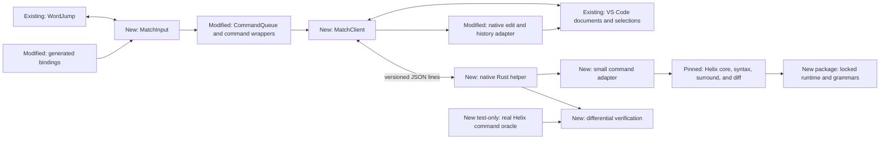

> **SUPERSEDED (2026-10-24), historical only.** The user switched to a TypeScript-only implementation; see [../helix-match-typescript/spec.md](../helix-match-typescript/spec.md). Native code archived at /home/cosmincartas/work/archives/vscode-extension-helix-match-native-20261024.

# Helix Match Specification

## Intent and Delivery Scope

The user requested all Helix inside and around text objects, including `miw`, `mi{`, `mif`, `maw`, and `maf`.
The discussion expanded the scope to the full `m` menu: `mi`, `ma`, `mm`, `ms`, `mr`, and `md`.
The user requested the most maintainable and extensible solution with 100% Helix feature parity.
The discussed solution bundles a native Rust helper, grammars, queries, and configuration inside the extension.
The latest request was: “Write the design docs and implementation plan, and use claude code to review them”.

The outcome is exact match-command behavior against a pinned Helix reference.
This document specifies the implementation; it does not claim that the helper already builds or establishes parity.
The first implementation milestone must test that architecture before full implementation.

### Compatibility definition

The reference is Helix revision `ba40e547426b0f9896c8bdc699a4ab11f2b37dbc`.
This preserves the revision investigated in the preceding discussion, rather than following a moving branch.
The reference includes its Cargo lockfile, grammar revisions, language configuration, and runtime queries.

For identical text, language, runtime, configuration, selections, counts, parser state, and Git baseline, commands must produce identical semantic results.
Results include text, selection ranges, direction, primary selection, intermediate replacement selections, and failure behavior.
Tests must include upstream quirks and unsupported captures.
An absent capture in the pinned runtime is a reference no-op, not a reason to invent a replacement.

Parity applies to the full match family in the extension's existing NORMAL mode.
Full Helix editor emulation, SELECT mode, registers, macros, unrelated navigation, and global repeat commands remain outside this change.
Repeated match commands and count behavior remain included.
The adapter must preserve command information needed by future repeat support. Alt-`.` remains excluded from this change.
The design must not claim full-editor parity.
NORMAL Escape must use Helix's no-op selection behavior and clear a pending count.
This necessary input integration prevents helper timing from deciding whether Escape clears a completed match selection.
It changes the current fall-through to native VS Code Escape. INSERT Escape keeps its existing behavior.

VS Code draws a forward selection's caret differently from Helix.
The selected text and subsequent command inputs must still match.
Rendering differences do not excuse different selections or edits.
The parity domain uses valid Unicode scalar text representable by Helix.
Malformed UTF-16 must produce a controlled unsupported-text result without lossy replacement.
Editor parity uses the text and EOL exposed by VS Code, after any host normalization.
It does not compare different disk-loading normalization policies.
Helper-only tests may cover additional exact-text states that the editor cannot expose.

### Baseline and provenance

Repository facts come from the current working tree, not only the recorded commit.
Existing changes affect `package.json`, `scripts/keybindings.cjs`, `src/extension.ts`, and several motion tests.
An untracked `test/unit/helixMovement.test.ts` is also present.
Concurrent work later added native navigation, additional motion tests, keyboard-test changes, keybinding tests, and README changes.
The final recheck also found queue support in `registerMotion` and character motions, plus `Count.presses` tracking.
Planning must preserve these changes.
No `AGENTS.md` was found in the repository or inspected ancestor directories.

Research date: 2026-10-24.
The source archive was downloaded from the exact upstream revision and inspected locally.
Its SHA-256 is `c5e35c68897a0f3793937095d8d9c13340fa18e727a3696ae16fa0edd1d08d23`.
This archive checksum records research evidence; implementation must also lock every build input.

| Evidence | Finding |
|---|---|
| `src/extension.ts:activate` | Registers synchronous motions, count commands, edit history, mode changes, and `gw`. |
| `src/core/count.ts:Count` | Count prefixes already exist; their maximum is 100,000,000. |
| `src/core/registerMotion.ts:registerMotion` | Accepts a shared queue; current activation supplies it for word and character motions. |
| `src/vscode/queue.ts:CommandQueue` | Edits, history, and mode commands use one queue. |
| `src/vscode/editing.ts:SelectionEdits` | Applies native editor edits and coordinates revision history. |
| `src/vscode/history.ts:UndoHistory` | Tracks Helix-style revisions over native undo. |
| `src/vscode/wordJump.ts:WordJump` | Owns transient label input and cancellation. |
| `src/vscode/navigation.ts:registerNavigation` | Concurrent native navigation uses the existing queue and must join cancellation checks. |
| `scripts/keybindings.cjs:createKeybindings` | Generates NORMAL blockers and temporary input bindings. |
| `test/unit/helix.ts:Session` | Runs extension algorithms; it is not an independent Helix oracle. |
| `test/integration/keyboard.ts:Keyboard` | Exercises actual renderer keybindings through CDP. |
| `.vscodeignore` | Excludes source, test, and script trees; native assets need explicit package inspection. |

External evidence uses primary sources:

- [Pinned keymap](https://github.com/helix-editor/helix/blob/ba40e547426b0f9896c8bdc699a4ab11f2b37dbc/helix-term/src/keymap/default.rs): the complete `m` menu has six commands.
- [Pinned command handlers](https://github.com/helix-editor/helix/blob/ba40e547426b0f9896c8bdc699a4ab11f2b37dbc/helix-term/src/commands.rs): `select_textobject`, `match_brackets`, and surround handlers define orchestration.
- [Pinned text objects](https://github.com/helix-editor/helix/blob/ba40e547426b0f9896c8bdc699a4ab11f2b37dbc/helix-core/src/textobject.rs): word and syntax objects ignore counts; other objects have distinct rules.
- [Pinned selection model](https://github.com/helix-editor/helix/blob/ba40e547426b0f9896c8bdc699a4ab11f2b37dbc/helix-core/src/selection.rs): normalization and grapheme invariants affect observable ranges.
- [Pinned syntax adapter](https://github.com/helix-editor/helix/blob/ba40e547426b0f9896c8bdc699a4ab11f2b37dbc/helix-core/src/syntax.rs): syntax uses `tree-house` and incremental changesets.
- [Pinned runtime loader](https://github.com/helix-editor/helix/blob/ba40e547426b0f9896c8bdc699a4ab11f2b37dbc/helix-loader/src/lib.rs): ordinary lookup includes user runtime directories before `HELIX_RUNTIME`.
- [Pinned grammar loader](https://github.com/helix-editor/helix/blob/ba40e547426b0f9896c8bdc699a4ab11f2b37dbc/helix-loader/src/grammar.rs): native grammars use shared libraries; WASM loading is unimplemented.
- [Pinned Git provider](https://github.com/helix-editor/helix/blob/ba40e547426b0f9896c8bdc699a4ab11f2b37dbc/helix-vcs/src/git.rs): the baseline comes from HEAD, with worktree conversions and trust handling.
- [Pinned diff implementation](https://github.com/helix-editor/helix/blob/ba40e547426b0f9896c8bdc699a4ab11f2b37dbc/helix-vcs/src/diff.rs): hunk selection depends on Helix's own diff behavior.
- [Platform packages](https://code.visualstudio.com/api/working-with-extensions/publishing-extension#platformspecific-extensions) support native target packages.
- [Remote extension hosts](https://code.visualstudio.com/api/advanced-topics/remote-extensions) determine where workspace extensions and native processes run.
- [Rust C runtime linkage](https://doc.rust-lang.org/reference/linkage.html#static-and-dynamic-c-runtimes) explains musl defaults and explicit dynamic-runtime selection.

Recommendations below are necessary consequences of exact parity and the bundled-helper approach.
Optional enhancements remain excluded.

## Functional Requirements

All rows have selection `included`.
Inferred rows are recommended mandatory requirements accepted under the documentation delegation recorded below.
Each verification compares observable behavior through supported commands or process messages.

| ID | Requirement | Source | Observable verification |
|---|---|---|---|
| FR-1 | The extension must select inside objects with `mi<object>`. | User examples. | Compare every object family against pinned Helix. |
| FR-2 | The extension must select around objects with `ma<object>`. | User examples. | Compare every object family against pinned Helix. |
| FR-3 | The extension must execute `mm` with Helix matching-bracket behavior. | Full-match discussion. | Compare syntax and plaintext matching, including missing matches. |
| FR-4 | The extension must add surrounds with `ms<input>`. | Full-match discussion. | Compare arbitrary characters, delimiter aliases, and Enter. |
| FR-5 | The extension must replace surrounds with `mr<old><new>`. | Full-match discussion. | Compare preview selections, replacement, cancellation, and restoration. |
| FR-6 | The extension must delete surrounds with `md<input>`. | Full-match discussion. | Compare nested, closest-pair, and partial-failure cases. |
| FR-7 | Match commands must preserve Helix selection normalization and primary-selection behavior. | Inferred from exact parity. | Compare Unicode, reversed, empty, overlapping, and multiple selections. |
| FR-8 | Match input must consume counts and pending keys according to pinned handlers, including NORMAL Escape without selection changes. | Inferred from parity and existing counts. | Replay counted commands, Escape at different helper speeds, invalid keys, and `gw` interactions. |
| FR-9 | The helper must apply the pinned syntax runtime for language objects and injections. | Inferred from all objects. | Inventory every runtime language and test available captures and injected layers. |
| FR-10 | Git objects must select Helix-compatible change hunks. | All-object discussion. | Compare HEAD-based changes, deletion hunks, absent baselines, and unsaved edits. |
| FR-11 | The extension must commit helper edits as native undoable changes. | Inferred from existing history contract. | Run surround edit, `u`, `U`, and native undo without duplicate edits. |
| FR-12 | The extension must reject stale helper results before they affect text or selections. | Inferred from asynchronous execution. | Delay results during native edits, cursor moves, editor switches, and cancellation. |
| FR-13 | Each supported native package must include the helper and complete pinned match runtime. | Bundled-helper discussion. | Install offline without Rust or Helix; execute language and Git objects. |
| FR-14 | Failed helper sessions must recover from authoritative VS Code state. | Inferred from a persistent helper. | Kill the helper before and after commits; verify no lost or duplicated edits. |

Excluding FR-7 through FR-14 would break exact behavior, existing editing behavior, or reliable bundled operation.

## Non-Functional Requirements

All rows have selection `included` and recommendation `Recommended mandatory`.
Sources are the maintainability request and necessary consequences of local native execution.
No unmeasured latency or memory target is asserted.

| ID | Requirement | Reason and consequence of exclusion | Observable verification |
|---|---|---|---|
| NFR-1 | Build inputs and compatibility identity must be locked and inspectable. | Unlocked assets make parity claims unstable. | Rebuild using locked sources; compare source and asset manifests. |
| NFR-2 | Production match algorithms must reuse pinned Helix code with a documented minimal adapter. | Parallel algorithm ports increase drift. | Review the upstream patch inventory and run differential tests. |
| NFR-3 | Helper communication must remain local and exclude document contents from diagnostics. | Native process boundaries must preserve document privacy. | Inspect process arguments, logs, ports, and offline operation. |
| NFR-4 | Installed assets must not load executable code or runtime overrides from the workspace. | Runtime shadowing breaks safety and parity. | Seed malicious user and workspace runtimes; verify they are ignored. |
| NFR-5 | Helper work must not block the extension host event loop. | Parser or Git work can delay editor input. | Inject slow parsing; observe responsive editor actions and cancellation. |
| NFR-6 | Release evidence must cover the declared platform and language matrices without silent omissions. | Missing grammars or targets invalidate completeness. | Audit target manifests, grammar loads, queries, captures, and CI results. |
| NFR-7 | Extension updates must preserve upstream and dependency license notices and required source availability. | Bundled dependencies require an explicit distribution audit. | Audit package notices, source references, and modified upstream files. |

## Excluded and Deferred Requirements

| ID | Proposal | Selection | Reason and consequence |
|---|---|---|---|
| FR-15 | Browser-only execution through WASM. | deferred | Native deployment was discussed. No parity claim covers a browser-only host. |
| FR-16 | Full Helix SELECT mode, macros, registers, and global repeat bindings. | excluded | These require wider editor emulation beyond match-mode work. |
| FR-17 | User grammar downloads and `.helix` configuration overrides. | deferred | A fixed runtime gives reproducible parity and avoids executable workspace assets. |
| FR-18 | Language-server approximations for missing syntax captures. | excluded | Approximate selections conflict with exact pinned behavior. |
| NFR-8 | A fixed latency, memory, or VSIX-size threshold. | deferred | No measured baseline or approved numeric limit exists. Record measurements before proposing limits. |

These proposals are optional. Their exclusion does not reduce the pinned NORMAL match-command set.

## Framed Ledger

| Category | Status | Decision or section reference | Open issue or omission reason |
|---|---|---|---|
| UI | approved | UI; delegated documentation workflow | None. |
| Architecture (HLD) | approved | Architecture; bundled native helper | None. Feasibility remains an implementation gate. |
| Models | drafted | Models | None. |
| Contracts | drafted | Contracts | None. |
| Functions | drafted | Functions | None. |
| Interfaces or Classes | drafted | Interfaces | None. |
| Behavior | drafted | Behavior | None. |
| Failure Model | drafted | Failure Model | None. |
| Traceability | drafted | Traceability | None. |

### Approval Records

- **Scope, UI, and HLD:** Accepted under the limited delegated documentation workflow on 2026-10-24.
  - Evidence: The user requested both documents after discussing complete match support and bundled native deployment.
  - Workflow: `quickie` coordinates `design-specs` and `implementation-plan` without routine approval stops.
  - Limits: Preserve that direction. Do not implement, publish, replace existing work, or claim direct user review.
  - Validity: Current. Platform feasibility and release parity require implementation evidence.
- **Final validation:** Completed under the limited documentation delegation on 2026-10-24.
  - Evidence: Source inspection, artifact consistency checks, and three Claude Code review passes.
  - Disposition: All reported findings have corrections recorded in `review.md`; the last popup correction received author checks.
  - Limits: No direct user review, native build, implemented behavior test, or release parity validation is claimed.

## UI

### UI-1: Match input in the existing status bar

Requirements: FR-1 through FR-8, FR-12, and FR-14.
Keep input in the text editor. Use the existing named status bar item for pending keys and operation errors.
Do not open a webview or Quick Input box for match characters.

```text
NORMAL          idle
NORMAL 3m       waiting for a match action
NORMAL 3mi      waiting for an inside object
NORMAL ms       waiting for a new surround character or Enter
NORMAL mr       waiting for the old surround character
NORMAL mr(      waiting for replacement; delimiter selections appear in the editor
NORMAL          command completed or cancelled
```

Use the reference command's count behavior, even when its algorithm ignores counts.
Show a temporary working indication while a completed command awaits the helper.
Show reference match errors in the status bar.
Show a concise helper-unavailable error for infrastructure failures; preserve text and mode.

Escape consumes pending input according to its phase; replacement preview restores the original selections.
Outside pending input, NORMAL Escape clears only the count and leaves selections unchanged.
Route this Escape action through extension command ordering; do not let native Escape clear a completed match selection.
The idle NORMAL Escape binding must defer while a VS Code popup owns Escape.
Exclude hover, peek, diagnostic-navigation, suggestion, parameter-hint, and rename-input contexts from that idle binding.
Use the actual supported VS Code context keys; verify them on the minimum and current supported versions.
Popup dismissal retains native behavior. Pending match callbacks retain their phase-specific input rules.
During replacement preview, cancellation restores the original selections only when the same session still owns them.
Never restore an old selection over a later user action.
Editor changes, document changes, mode changes, and suspension cancel invalid pending ownership.
Focus loss alone must preserve pending input, as Helix does.
Command-owned preview changes must not cancel their own session.

Read-only editors permit `mi`, `ma`, and `mm`.
They reject `ms`, `mr`, and `md` before changing selections or starting transactions.
No active text editor means no pending session.
The status bar must expose its state through accessible text and tooltip content.
Its full pending state must remain available through the tooltip when space is limited.

### UI-2: Scoped character input

Match input and word-jump label input must have one active owner.
Generated bindings must pass logical characters, including shifted punctuation, to that owner.
They must override existing NORMAL edit keys while a match action is pending.
During the action-menu phase, digits follow `Count` rules. During callback phases, digits are match characters.
Outside a pending session, existing INSERT typing and modified shortcuts retain their current behavior.
During callback phases, character keys reach the match owner even with Ctrl or Alt modifiers.
Helix uses their character value regardless of those modifiers: `mi<Alt-w>` selects a word, and `ms<Ctrl-x>` adds `x`.
The action-menu phase still uses exact keymap matching, including modifier distinctions.
Non-character keys consume the callback without edits; during replacement preview, they restore original selections.
Enter has its special add-surround meaning only in the add callback.
Implementing this policy requires real keyboard tests, including rapid input and non-US layouts.

VS Code keybinding strings do not provide an unrestricted text-input stream.
The feasibility milestone must demonstrate actual Unicode surround input through the real editor.
It must also demonstrate modified-character routing and ordered key replay after a failed replacement lookup.
If scoped bindings cannot deliver required characters, evaluate a temporary, focus-scoped `type` handler during match input only.
The handler must delegate native typing outside its guarded session and must handle composition without duplicate input.
This is a permitted implementation mechanism for the required input behavior, not permission to change normal typing globally.
Failure to establish arbitrary-character input blocks a full-parity release.

## Architecture (HLD)

### Architecture Decisions

1. Bundle one persistent Rust helper per extension-host instance. Communicate over private stdin and stdout.
2. Reuse pinned `helix-core`, `helix-loader`, `helix-vcs`, and required upstream support crates.
3. Adapt only the command orchestration currently private to `helix-term`.
4. Keep source provenance and upstream modifications in one reviewed vendor or source-bundle boundary.
5. Keep VS Code authoritative for text, editor identity, user selections, and undo history.
6. Give Rust ownership of syntax trees, diff computation, Helix selection semantics, and match transactions.
7. Send exact document text and versioned changes. Do not normalize line endings or append hidden newlines.
8. Queue every extension command that can observe or modify affected text or selections.
9. Lock the full runtime. Do not merge ambient Helix configuration or load external grammar libraries.
10. Verify behavior against actual pinned Helix command dispatch, separately from the production adapter.

The native approach avoids maintaining a second implementation of Helix algorithms.
The TypeScript-plus-queries alternative needs ports of selection, syntax, surround, and diff behavior.
WASM needs additional upstream integration because the pinned grammar loader does not implement it.
The native approach adds build targets, package size, process lifecycle, and synchronization responsibilities.



### Components

| Component | State and entry point | Responsibility |
|---|---|---|
| Activation | Modified `src/extension.ts:activate` | Construct sessions and client; dispose helper; preserve current settings. |
| Keybinding generator | Modified `scripts/keybindings.cjs:createKeybindings` | Route match actions, characters, counts, and cancellation. |
| Input session | New `src/core/matchInput.ts:MatchInput` | Own pending action state independently of context-key update timing. |
| Editor coordinator | New `src/vscode/match.ts:MatchController` | Capture editor state, apply previews, validate results, and commit edits. |
| Command queue | Modified `src/vscode/queue.ts:CommandQueue` and callers | Preserve command order across asynchronous match work and existing motions. |
| Process client | New `src/native/matchClient.ts:MatchClient` | Spawn packaged helper; frame messages; track versions; recover and dispose. |
| Selection boundary | New `src/native/selectionCodec.ts` | Convert UTF-16 positions and maintain primary-selection identity. |
| Native helper | New `native/match-helper/` | Own document replicas and execute typed match requests. |
| Helix adapter | New module inside the helper | Call upstream algorithms and reproduce only required `helix-term` orchestration. |
| Runtime manifest | New `native/helix-lock.json` | Lock compatibility, asset inventory, source revisions, checksums, and notices. |
| Oracle | New test-only upstream harness | Execute real pinned commands without using production adapter logic. |
| History | Modified `src/vscode/history.ts:UndoHistory` integration | Record each surround edit as one native-backed revision. |

No new class hierarchy is required. File names identify boundaries, not private decomposition.

### Architectural Flow

1. A key enters the active input owner. `m` starts a session without consuming the pending count.
2. The input state machine collects the command's remaining keys without invoking unrelated edit commands.
3. A completed command enters the shared queue. It captures the current document and selection state at execution time.
4. The client synchronizes that exact version and sends one typed operation for all selections.
5. Rust converts offsets, applies upstream selection invariants, and evaluates the command without mutating authoritative text.
6. The response describes proposed edits, post-edit selections, status, and any replacement-preview state.
7. The coordinator validates ownership and freshness, then applies one native transaction or one selection update.
8. Native document events synchronize the committed text back to Rust. A proposal alone never changes the replica.
9. A failed or cancelled proposal leaves authoritative text unchanged.

### Deployment and feasibility gate

Set `extensionKind` to `workspace` for the native design.
The helper executes on the extension host, including SSH, WSL, containers, and Codespaces with a Node extension host.
A browser client with a remote Node host can work; a browser-only extension host cannot launch the helper.

The target matrix is `win32-x64`, `win32-arm64`, `darwin-x64`, `darwin-arm64`, `linux-x64`, `linux-arm64`, `linux-armhf`, `alpine-x64`, and `alpine-arm64`.
These are planned release targets, not validated build results.
Each target needs compatible grammar libraries and system ABI checks.
Alpine helpers must use dynamic musl linkage that permits loading packaged grammar libraries.
The Alpine probe must load and use a grammar inside Alpine; successful compilation alone is insufficient.
A failed target must block that target's release; dropping a declared target requires a reviewed scope change.

Package the helper, native grammar libraries, runtime queries, manifest, and notices in each target VSIX.
Do not download, compile, or repair grammars on the user's machine.
No Rust or Helix installation is required.
Do not launch language servers, debug adapters, or shell commands for syntax text objects.
Git baseline conversions may run trusted filters only through the pinned upstream trust policy.

The first milestone must build a minimal helper and package it for the current host.
It must demonstrate a word, a function, an injected language, surround editing, a Git hunk, and Unicode input.
It must report startup time, warm command latency, parse latency, memory, and package size.
No latency threshold is assumed until measurements support one.
An architectural failure requires design review before dependent implementation.
This gate is planned work, not an unresolved design choice disguised as completed validation.

## Models

### Document and selection identity

VS Code owns a document snapshot: URI, open generation, version, language ID, exact text, and line-ending preference.
Each reopen gets a new document ID even when the URI is unchanged.
Rust maintains an ephemeral replica keyed by that ID.
Each helper restart gets a new helper epoch.

Wire offsets use zero-based UTF-16 code units into the exact VS Code snapshot.
Ranges use gap endpoints: `{anchor, head}`. The primary range has an explicit index.
Rust converts these offsets to Unicode scalar indices before constructing Helix ranges.
Helix and tree-sitter byte offsets stay inside Rust.
Selection conversion must not assume that one grapheme, scalar, UTF-16 unit, or byte has equal width.

Helix normalizes the complete selection set, including grapheme alignment and minimum width where applicable.
Do not independently merge selections using VS Code's rules before upstream normalization.
Project the primary selection to index zero for VS Code, while preserving canonical ordering in semantic state.
The milestone must establish whether any reachable normalized Helix selection loses information during VS Code projection.
CRLF is one grapheme; normalized reference results must not create a gap inside it.
Do not implement special CRLF shadow ranges for states that upstream invariants cannot produce.
Retain only semantic metadata needed to preserve reachable selections, including canonical ordering and primary identity.
Invalidate retained metadata on external document or selection changes.
Projection must preserve subsequent match, `c`, and `d` inputs; a reproduced loss blocks parity.

### Match session

```ts
type MatchAction = 'inside' | 'around' | 'brackets' | 'add' | 'replace' | 'delete';
type MatchModifiers = readonly ('shift' | 'ctrl' | 'alt' | 'meta')[];
type MatchKey =
  | { kind: 'char'; value: string; modifiers: MatchModifiers }
  | { kind: 'enter'; modifiers: MatchModifiers }
  | { kind: 'other'; code: string; modifiers: MatchModifiers };
type MatchPhase = 'action' | 'object' | 'add' | 'old' | 'new';
type MatchSession = {
  sessionId: number;
  editorGeneration: number;
  documentId: string;
  count?: number;
  phase: MatchPhase;
};
```

A character value is exactly one Unicode scalar. Invalid character strings fail validation.
Retain modifier and key identity for action-menu matching and ordinary-input replay.
Callback phases use the character value and ignore character modifiers, as upstream `KeyEvent.char()` does.
Canonicalize shifted character keys before action-menu matching, using the pinned input rules.
During the action phase, the shared `Count` remains mutable under the pinned command-mode digit rules.
The accepted action consumes and snapshots that count; subsequent object or surround digits are character input.
Replacement preview additionally holds original selections, preview selections, and a native continuation token.
The token binds the exact document version, semantic original selection, selected delimiter positions, count, and session.
It expires on cancellation, document change, helper restart, or successful replacement.
It must not authorize edits to another snapshot.

## Contracts

### Private process protocol

Use UTF-8 JSON Lines over the child process pipes.
Every message ends with one newline. Embedded text newlines use JSON escaping.
Stdout contains protocol messages only. Sanitized operational logs use stderr.
Use bounded buffering and validate message structure before allocation or offset conversion.
The implementation must declare frame limits and timeout policy in one place and test their failure paths.
These limits must produce explicit errors; they must never truncate documents or commands.

Every request carries `protocolVersion`, `requestId`, and `helperEpoch` after initialization.
Every response echoes them and returns either a typed result or a stable error code.
An unknown protocol version or incompatible runtime identity terminates match availability for that session.

| Method | Request fields beyond the envelope | Result |
|---|---|---|
| `initialize` | Expected Helix revision, runtime hash, target, protocol version | Actual compatibility identity and capabilities |
| `open` | Document ID, URI, optional local path, generation, version, language ID, text, EOL, trust state | Acknowledged version and selected language |
| `change` | Document ID, base version, next version, edits against the base snapshot | Acknowledged version or `resync_required` |
| `snapshot` | Document ID and complete replacement snapshot | Acknowledged version; clears continuations |
| `configure` | Document ID, version, language ID, EOL, trust state | Updated metadata; clears incompatible parser and diff state |
| `evaluate` | Document ID, version, session ID, ordered ranges, primary index, action, count, typed input keys, selection generation, baseline identity when required | Proposal or replacement preview |
| `continue` | Document ID, version, continuation token, replacement key, selection generation | Replacement proposal or restored semantic selections |
| `cancel` | Session ID or continuation token | Released continuation |
| `close` | Document ID | Replica and continuation removal |
| `shutdown` | No document fields | Graceful exit |

Replica acknowledgements include `syntaxState`: `available`, `no_language`, `no_grammar`, `initial_failure`, or `update_failure`.
`open` and `snapshot` accept the retained state for recovery of the same document generation.
The helper validates that retained state against the current language and compatibility identity.
`configure` returns the resulting state after the equivalent upstream language operation.

Operations for one replica are processed in order.
Changes in one VS Code event refer to its original base snapshot.
Validate non-overlap, then apply them as one changeset; never reinterpret later offsets against earlier edits.
The helper updates syntax using the original rope, resulting rope, and upstream changeset.
Acknowledgements include syntax availability and its lifecycle state.
The client retains that state for the current document generation and restores it after transport resynchronization or helper restart.
Snapshots must not silently re-enable syntax that upstream disabled after an update failure.
Language reconfiguration resets syntax only when the equivalent upstream operation does.
Undo, redo, paste, formatter changes, and external edits use the same synchronization path.
`snapshot` replaces the replica when any version gap or unsupported change occurs.

A proposal contains `baseVersion`, `selectionGeneration`, `sessionId`, sorted non-overlapping text edits, final semantic selections, primary index, and status.
All edit coordinates refer to the base document. Result selections refer to the complete post-edit document.
A preview contains no text edits and includes semantic original selections and an opaque continuation token.
Neither response updates the helper's text replica.
The eventual native change event is the only commit input.

Stable infrastructure errors include `resync_required`, `stale_continuation`, `invalid_request`, `unsupported_text`, `runtime_unavailable`, and `internal_error`.
Reference no-match behavior remains a successful no-op or reference error, according to the upstream handler.
It must not be confused with a broken grammar asset or helper crash.

### Freshness and commit contract

Before every visible effect, validate the helper epoch, request ID, document generation, version, editor identity, selection generation, mode, and enabled state.
Selection generation changes for native mouse actions, navigation, and other commands.
Command-owned preview or result events update the tracked projection without invalidating their own owner.
Validate edit bounds, Unicode boundaries, result selection bounds, and transaction consistency.

Use `TextEditor.edit` for a single-document transaction.
VS Code 1.85 captures the document version in its [extension-host edit builder](https://github.com/microsoft/vscode/blob/1.85.0/src/vs/workbench/api/common/extHostTextEditor.ts#L63).
Its [main-thread edit path](https://github.com/microsoft/vscode/blob/1.85.0/src/vs/workbench/api/browser/mainThreadEditor.ts#L473) rejects a different model version.
Validate immediately before calling it, without an intervening `await`.
Honor its boolean result; rejected edits must not change selections or history.
Do not replay a failed or stale edit automatically.
Before implementation proceeds, the feasibility gate must verify concurrent-edit rejection using the supported VS Code API.
If that API cannot protect the base version, choose a supported version-guarded edit path and update the contract before release.

After successful application, wait for the acknowledged native document event and verify the resulting version and text changes.
If another edit intervenes before selection installation, keep the accepted document changes but skip stale selection installation and resynchronize.
History must record only the changes that actually committed.
Never roll back a successful user document change because the helper stopped responding.

### Runtime and language contract

`native/helix-lock.json` must record the revision, source checksums, Rust toolchain, Cargo lock hash, runtime hash, grammar sources, and target artifacts.
It must inventory all configured languages, grammars, query inheritance, and available text-object captures.
The pinned configuration contains 342 language entries, 303 grammar definitions, and 158 text-object query files.
Its default `use-grammars` selection excludes `wren` and `gemini`, leaving 301 selected grammar definitions.
Preserve that selection in both the package and oracle; record intentional exclusions explicitly in the manifest.
An intentionally excluded grammar is reference configuration, not a broken installation.
The runtime must include all assets used by match behavior, including injections and bracket-related queries.
Absent object captures must remain absent.
Checksum failures and unexpectedly missing packaged libraries are installation errors.
An unchanged pinned query that also fails in the reference follows that query type's upstream failure behavior.
Record its path and failure class in the inventory; do not repair it or convert it into an installation error.
Apply equivalent reference fallback behavior for syntax initialization and update failures.

Map VS Code language IDs through a documented alias table, then the pinned loader's language detection rules.
Use pinned file and content detection when no alias applies.
Unknown languages use reference plaintext behavior.
Test ambiguous aliases, file extensions, shebangs, untitled files, and language changes.

Patch or inject runtime resolution so it searches only the packaged root.
Setting `HELIX_RUNTIME` alone is insufficient because higher-priority runtime locations exist upstream.
Record this narrow isolation patch in the upstream patch inventory.
Ignore workspace `.helix` files, user Helix files, inherited runtime variables, and user grammar libraries.
No general Helix editor configuration is merged.

### Syntax lifecycle contract

Preserve the pinned parser's 500 ms timeout and document-level failure policy.
An initial parse failure leaves syntax unavailable: capture objects become no-ops, and pair matching follows the plaintext branch.
An incremental syntax-update failure disables syntax for that document, as upstream `Document.apply_impl` does.
Further text changes must not silently retry or re-enable it.
Keep the disabled state through helper recovery for the same document generation.
A `textobjects.scm` failure produces the upstream missing-object-query result while retaining other available syntax behavior.
A root `highlights.scm`, `injections.scm`, or `locals.scm` failure makes syntax initialization fail.
Represent that root configuration failure as `initial_failure`; pair matching uses plaintext and capture objects become no-ops.
A failed configuration for an injected language removes that layer while preserving any valid enclosing layers.

Parser availability and edit history are part of the compared reference state.
Do not demand identical wall-clock timeout outcomes from separate runs on different hosts.
Use deterministic failure injection in helper and oracle tests to verify the same state transitions and resulting match behavior.
Exclude uncontrolled timing races from deterministic fixtures, while testing the timeout policy separately.

### Git baseline contract

Rust uses pinned `helix-vcs` baseline loading and diff behavior.
It compares the exact unsaved replica with the HEAD baseline after upstream worktree conversions.
Pass VS Code workspace trust to the upstream Git trust boundary.
Untrusted workspaces must not execute repository-local filter programs.
Inherited Git behavior that differs by trust must be tested against the reference's equivalent trust state.

The baseline identity includes repository, HEAD, path, relevant conversion configuration, and trust state.
Refresh the baseline before each Git-object evaluation; cache only when that identity remains valid.
Do not use VS Code SCM decorations as hunk inputs.
For local paths, use the upstream lookup result even when the working file was deleted.
Do not invent an empty baseline for untracked, untitled, virtual, or unavailable documents.
Return reference unavailable behavior only when the corresponding baseline lookup is unavailable.
Both `mig` and `mag` use the pinned hunk range rules, including pure deletions and line-to-character conversion.
The oracle must settle asynchronous diffs before comparing results.

## Functions

| Entry point | Inputs and effects | Error behavior |
|---|---|---|
| `MatchInput` new public reducer | Current state and logical key; returns transition and operation intent. | Invalid input cancels according to the reference phase. |
| `MatchController` new command handlers | Editor state and match intent; queues snapshots, previews, edits, and selections. | Reject stale results; release preview ownership. |
| `MatchClient` new process boundary | Typed requests and document events; manages replicas and helper identity. | Reject pending calls on exit; restart from snapshots. |
| Native `evaluate` new dispatcher | Versioned text, semantic selections, action, count, and keys. | Reference outcomes or typed infrastructure failures. |
| Native `continue` new dispatcher | Bound continuation and replacement key. | Reject expired tokens without edits. |
| `UndoHistory.hold` and `commit` existing | Surround edit revision boundaries. | Commit only an accepted edit; do not create an empty revision on failure. |

## Interfaces

Use typed request and response unions on each side of the process boundary.
Keep protocol version constants and fixture examples under one compatibility check.
Do not expose the process protocol as a public extension API.
The existing `MiniHelixApi.getState()` remains compatible.

```ts
interface MatchService {
  evaluate(request: MatchRequest): Promise<MatchResponse>;
  continue(request: ContinueRequest): Promise<MatchResponse>;
  cancel(sessionId: number): Promise<void>;
  dispose(): void;
}
```

Request types must implement the contract above. Private helpers and implementation classes remain discretionary.

## Behavior

### Object inventory

| Input after `mi` or `ma` | Native reference operation |
|---|---|
| `w`, `W` | `textobject_word`, with word or WORD behavior |
| `p` | `textobject_paragraph` |
| `m` | `textobject_pair_surround_closest`, with syntax when available |
| Non-ASCII-alphanumeric characters | `textobject_pair_surround`, with syntax when available |
| `f`, `t`, `a`, `c`, `T`, `e`, `x` | `function`, `class`, `parameter`, `comment`, `test`, `entry`, `xml-element` captures |
| `g` | Current change hunk from the pinned diff handle |
| Other characters | Preserve the reference unsupported-object behavior |

Do not reduce delimiter input to a hard-coded bracket list.
The upstream predicate also admits non-ASCII letters as custom pair characters.
`m` means closest surround in object selection and old-surround lookup.
It remains a literal new surround character during add and replacement output.

### Pending input and ordering

`idle → m → action` begins a session.
`i` and `a` then wait for an object.
`s` waits for a new surround key.
`d` waits for an old surround character.
`r` waits for an old character, requests preview, then waits for a new character.
`m` executes bracket matching immediately.
Digits before the action can start or extend the count, including after the initial `m`.
For example, `m3i{` uses count three, and `2m3i{` uses count twenty-three.
After `mi`, `ma`, `ms`, `mr`, or `md`, digits follow the command callback's character rules.
Use `Count.take()` when accepting the action, rather than on the initial `m`.

The state machine owns phase transitions synchronously, before asynchronous context-key publication.
Buffer keys received while a preview request is pending, and process them in input order.
This includes Escape; first determine whether lookup installed a replacement callback or returned to NORMAL dispatch.
If old-surround lookup fails, no replacement callback exists; replay buffered keys through ordinary NORMAL dispatch in order.
Only a reference lookup failure triggers replay.
Infrastructure errors, stale results, and ownership cancellation discard the buffered keys without replay or edits.
Report infrastructure errors; ordinary user cancellation stays silent.
For example, `mr(d` without a pair reports the lookup error and then executes ordinary `d`.
Preserve complete logical key identity during replay, including modifiers and non-character keys.
Escape consumes only an unfinished input phase; it must not cancel a completed command waiting in the queue.
For example, delayed `miw<Escape>` must still leave the word selected.
The same result must hold when `miw` finishes before Escape arrives, through the explicit NORMAL Escape binding.
External state changes can invalidate completed results through freshness checks.
Invalid key handling must follow the corresponding upstream handler, including restoration after replacement preview.

The shared queue must cover existing word and character motions, edits, undo, redo, mode changes, and completed match actions.
Capture execution snapshots inside the queue so `miwd` deletes the resulting word.
Capture session identity at input time so a queued operation cannot act in a different editor.
Revalidate active identity at execution and before application.
Do not capture stale selection offsets when merely enqueuing a later command.

### Surround edits and history

`ms` builds all insertions and resulting selections through the native adapter.
Enter uses the document's configured line ending, as the reference does.
`mr` finds all delimiter positions, exposes the reference preview selections, and creates a bound continuation.
Cancellation restores the original semantic selections only when ownership remains current.
`md` and `mr` retain the reference all-selection validation and error behavior.
Do not convert one selection's failure into partial edits.

Each successful add, replace, or delete is one native edit transaction and one Helix-style revision.
Normal selection-only operations do not create undo entries.
After a match selection, existing `c` and `d` must consume exactly the selected text.
This work does not change their existing register or indentation limitations.

### Recovery

A helper exit rejects all outstanding requests and invalidates every continuation.
The next explicit match action may start one new helper and synchronize current snapshots.
Do not retry failed edits automatically.
Disable repeated automatic restart attempts after another startup failure until an explicit action requests recovery.
Shutdown releases pipes, listeners, pending promises, syntax trees, diff workers, and child processes.
Closing a document releases its replica; document reopening never reuses old continuations.

### Upstream upgrades

Keep the helper adapter small and list each copied or patched upstream symbol with its source revision.
Use native upstream implementations whenever their API is suitable.
An upgrade changes the compatibility identity and reruns the complete differential and packaging matrices.
Review changed command handlers, runtime assets, query inventory, grammar licenses, and deliberate upstream quirks.
Never update only queries or grammars independently of the locked compatibility set.

## Failure Model

| ID | Failure and detector | Owner and response | Observable check |
|---|---|---|---|
| F-1 | Version or epoch mismatch. | Client rejects results and resynchronizes. | Delayed old responses cannot change text or selections. |
| F-2 | External selection or editor change. | Controller cancels ownership; skips restoration and stale application. | Mouse move or tab switch wins over a delayed preview. |
| F-3 | Native edit rejection or concurrent change. | Controller leaves selections untouched and records no failed revision. | Race a formatter against a surround edit. |
| F-4 | Missing packaged grammar, checksum failure, or runtime mismatch. | Helper reports installation failure; no approximate fallback. | Remove or corrupt an expected asset in a test package. |
| F-5 | Missing syntax capture or unmatched pair. | Adapter follows the reference outcome. | Compare missing-capture and multi-selection errors. |
| F-6 | Helper crash, hang, or malformed frame. | Client rejects calls, terminates the session, and permits explicit recovery. | Inject faults before preview, before commit, and after commit. |
| F-7 | Missing Git baseline or changed HEAD. | Git adapter refreshes identity or reports reference unavailability. | Use untracked files, linked worktrees, and HEAD changes. |
| F-8 | Invalid offsets, malformed UTF-16, or oversized frames. | Boundary rejects explicitly without truncation or lossy conversion. | Submit invalid requests through the process protocol. |
| F-9 | Unsupported target or missing system dependency. | Client preserves existing extension behavior and reports unavailable match support. | Start the installed package on each declared target. |
| F-10 | Workspace runtime shadowing or executable Git filters. | Runtime resolver ignores overrides; Git honors workspace trust. | Seed hostile assets and verify no untrusted execution. |
| F-11 | Reference query failure or parser timeout. | Preserve upstream fallback and persistent syntax-disable state. | Inject equivalent failures into the oracle and helper. |

## Traceability

| Requirement | Design coverage | Verification |
|---|---|---|
| FR-1 | UI-1; object inventory; native evaluator | Inside-object differential corpus. |
| FR-2 | UI-1; object inventory; native evaluator | Around-object differential corpus. |
| FR-3 | Architecture; native evaluator | Plaintext and syntax-aware bracket cases. |
| FR-4 | UI-2; surround behavior | Characters, aliases, Enter, Unicode, and native undo. |
| FR-5 | Continuation model; preview contract | Intermediate selection comparison and cancellation. |
| FR-6 | Surround behavior; all-selection validation | Nested, closest, and partial-failure cases. |
| FR-7 | Selection identity; semantic projection | Unicode/CRLF round trips and primary-selection comparisons. |
| FR-8 | Pending input; queue ownership | Counts, invalid keys, rapid input, and `gw` regression tests. |
| FR-9 | Runtime contract; language mapping | Complete asset inventory, capture matrix, and injection cases. |
| FR-10 | Git contract | HEAD-based hunk comparison with unsaved text. |
| FR-11 | History contract | One-step `u`/`U` and native undo checks. |
| FR-12 | Freshness and commit contract | Delayed-result and concurrent-edit tests. |
| FR-13 | Deployment | Offline installation and complete target packages. |
| FR-14 | Recovery | Crash, restart, close, and reopen tests. |
| NFR-1 | Compatibility identity; lock manifest | Locked rebuild and identity mismatch checks. |
| NFR-2 | Upstream adapter; upgrade procedure | Patch inventory and independent oracle comparison. |
| NFR-3 | Private process protocol | No ports, network requests, or document-bearing diagnostics. |
| NFR-4 | Isolated runtime and Git trust | Override and trust-boundary tests. |
| NFR-5 | Asynchronous client; shared queue | Slow-helper responsiveness and cancellation observations. |
| NFR-6 | Deployment and runtime matrices | Every declared target and configured language accounted for. |
| NFR-7 | Packaging and upgrade procedure | Notices and corresponding-source audit. |

## Verification Design

Build a test-only oracle from the exact upstream source.
Drive actual `helix-term` match key dispatch and command handlers with the pinned runtime.
Do not call the production command adapter from the oracle.
Shared upstream core code is intentional; separate command orchestration detects adapter drift.

Fixture inputs include text, selections, primary index, language, runtime identity, mode, keys, EOL preference, parser state, and Git baseline.
Expected outputs include intermediate previews, final text, semantic selections, status category, and commit outcome.
The oracle must use an in-memory document with the same text, without implicit file-loading newline changes.
Record fixture provenance and the reference identity.
Never generate expected results by running only extension code.

Cover empty files, EOF without a final newline, blank lines, CRLF, combining marks, emoji, and non-BMP characters.
Test mixed EOL and lone CR through helper/oracle fixtures; editor fixtures use VS Code's exposed text.
The [VS Code 1.85 text-buffer builder](https://github.com/microsoft/vscode/blob/1.85.0/src/vs/editor/common/model/pieceTreeTextBuffer/pieceTreeTextBufferBuilder.ts#L42) normalizes line endings during ordinary buffer creation.
Set the same EOL preference in the oracle, including files without any existing line break.
Cover nested pairs, escaped quotes, delimiter positions, empty objects, arbitrary pairs, aliases, and missing matches.
Cover every object code, positive and negative captures, language aliases, inherited queries, and nested injections.
Cover multiple and reversed selections, overlaps, primary changes, counted objects, malformed syntax, and reference quirks.
Add deterministic generated cases for selection and transaction combinations; retain seeds and minimized failures.

Each configured language needs an explicit inventory row.
Each available object capture needs a representative positive fixture or a reviewed documented reason for unavailable construction.
No undocumented language or grammar omissions are allowed.
Finite tests provide release evidence; they do not mathematically prove every possible input.
Reserve a parity claim for a complete audited matrix with zero unexplained semantic mismatches.

Run real keyboard tests for binding precedence, Enter, punctuation, Unicode, modified characters, read-only behavior, rapid sequences, and native undo.
Test the supported VS Code minimum and a current stable build.
Package tests must run the installed VSIX offline on each declared target.
Existing checks were inspected during design; implementation tests and native builds were not executed.

## Open Issues

No unresolved requirement or architecture choice blocks writing the implementation plan.
The feasibility milestone is a required go/no-go check before dependent implementation.
Its unverified points are native build viability, arbitrary Unicode input, selection projection, atomic edit rejection, and measured resource cost.
If a point fails, stop dependent work and review the affected design.
Do not reinterpret failure as permission to reduce the parity target.
