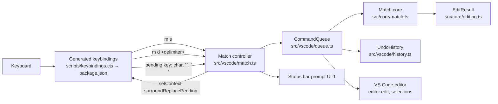

# Helix Surround Add and Delete Specification

## Intent and Delivery Scope

- **Intent:** [intent.md](intent.md)
- **Outcome:** In NORMAL mode, `ms<char>` wraps every selection in a pair, and `md<char>` deletes the enclosing pair around every cursor. Both commands match pinned Helix `ba40e547426b0f9896c8bdc699a4ab11f2b37dbc` where practical. The README lists each remaining difference.
- **Includes:**
  - `ms` with a printable character, a space, or Enter.
  - The selections after `ms`, and the count rule for `ms`.
  - `md` with the 11 delimiters that `mr` accepts, with a count.
  - The selections after `md`, and the all-or-nothing rule for `md`.
  - One undo step for each command, read-only rules, cancellation, and README updates.
- **Constraints:**
  - Match pinned Helix as much as possible. List every gap in the README. (User)
  - `md` finds pairs with the current `mr` rules, not with the Helix rules. (User, intent Constraints)
  - `mm` is out of scope. (User)
  - Use plain text scanning only. Do not add a parser or tree-sitter. (`README.md`; `docs/context-engineering/helix-match-typescript/spec.md`)
  - `scripts/keybindings.cjs` generates the keybindings in `package.json`. `npm test` fails when they differ. (`scripts/keybindings.cjs` `--check`)
  - Key input follows the US keyboard layout. (`scripts/keybindings.cjs` `typedCharacters`)

### Source labels

- **User:** a statement or a choice from the user.
- **Repo:** repository evidence, cited as `file:symbol`.
- **Helix:** pinned Helix source at `ba40e547426b0f9896c8bdc699a4ab11f2b37dbc`, read on 2026-10-24 from <https://github.com/helix-editor/helix>:
  - `helix-term/src/commands.rs`: `surround_add`, `surround_replace`, `surround_delete`
  - `helix-core/src/surround.rs`: `get_surround_pos`, `find_nth_pairs_pos`
  - `helix-core/src/match_brackets.rs`: `get_pair`, `PAIRS`
  - `helix-term/tests/test/commands.rs`: `surround_delete`
- **Inference:** a conclusion from these sources that the user has not stated.

### Resolution of the intent open questions

- **Intent question 1, `ms` on an empty selection:** An empty selection is the Helix block cursor. It covers the grapheme after it (Repo: `src/core/editing.ts:blockRange`). At the end of the text, the range stays empty (Repo: `blockRange`). Helix then puts both delimiters at that offset (Helix: `surround_add`). See FR-3.
- **Intent question 2, error message for `md`:** `md` makes no edit and shows no message, the same as `mr` (Repo: `src/vscode/match.ts:Match.input`). This keeps `md` consistent with `mr`, as the user chose for pair rules. The message is deferred. See the Excluded and Deferred Requirements section.
- **Intent question 3, oracle check:** The tests use expected values from pinned Helix source and its upstream `md(` test. A new oracle is excluded. See the Excluded and Deferred Requirements section.

## Functional Requirements

- **FR-1** — `ms<char>` must put the opening character before each selection and the closing character after it.
  - Selection: included
  - Source: User (intent Problem); Helix `surround_add` and `get_pair`
  - Rules:
    - A bracket or a closing bracket gives its pair: `ms(` and `ms)` both give `(text)`.
    - The 11 delimiters map with `src/core/match.ts:replacementPair`.
    - Any other printable character goes on both sides: `ms*` gives `*text*`.
    - A space goes on both sides: `ms<space>` gives ` text `. Helix `event.char()` returns `' '` for the space key.
  - UI: UI-1
  - Verification: Unit tests call the new core function for `(`, `)`, `*`, and a space. Integration tests type `ms(`, `ms)`, and `ms*` with the real keyboard and check the text.

- **FR-2** — `ms` followed by Enter or Shift+Enter must put the document line ending before and after each selection.
  - Selection: included
  - Source: User (intent Definition of done 3); Helix `surround_add` (`KeyCode::Enter`, `doc.line_ending`)
  - UI: UI-1
  - Verification: Unit tests use `\n` and `\r\n` line endings. An integration test types `ms` and Enter, then checks that the text is `\ntext\n`.

- **FR-3** — After `ms`, each selection must cover the selected text and the new delimiters. Its direction must not change.
  - Selection: included
  - Source: Helix `surround_add` (each new range runs from `from` to `to` plus the inserted length, `with_direction`)
  - Rules:
    - An empty selection uses `blockRange`, so `ms(` on a cursor before `b` in `abc` gives `a(b)c`, with `(b)` selected forward.
    - At the end of the text, `ms(` inserts `()` and selects it.
    - Adjacent selections each get their own pair: `[a][b]` gives `(a)(b)`.
    - The selections keep their order, so the primary selection stays primary.
  - Verification: Unit tests check the text and every selection, including reversed, empty, end-of-text, adjacent, and multi-selection cases.

- **FR-4** — `ms` must ignore a count. The count must clear.
  - Selection: included
  - Source: User (follow Helix counts); Helix `surround_add` (does not read `cx.count()`)
  - Verification: An integration test types `3ms(` and checks one pair of parentheses and an empty count.

- **FR-5** — After `ms`, Escape, Tab, Backspace, Delete, a navigation key, or Insert must end the command with no edit.
  - Selection: included
  - Source: Helix `surround_add` (`None => return`); Repo: the cancel bindings for a pending `mr`
  - UI: UI-1
  - Verification: An integration test types `ms` and Escape, then checks that the text and selections did not change and that the next key works normally. A unit test checks that each of these keys is bound to `miniHelix.cancelSurroundReplace` while a session is pending.

- **FR-6** — `md<char>` must delete the enclosing `<char>` pair around every cursor. It must find pairs with the current `mr` rules.
  - Selection: included
  - Source: User (intent Problem; "md like current mr"); Repo: `src/core/match.ts:findPair`, `delimiterPair`
  - Rules:
    - Only the 11 delimiters work: `'` `"` `` ` `` `(` `)` `[` `]` `{` `}` `<` `>`. A closing character is an alias.
    - Brackets match over the whole document, with nesting.
    - Quotes pair from left to right on one line. Escaped quotes are skipped.
  - Verification: Unit tests delete brackets, quotes, backticks, and aliases. Integration tests type `md(` and `md"` with the real keyboard.

- **FR-7** — `[count]md<char>` must delete the count-th enclosing pair.
  - Selection: included
  - Source: User (follow Helix counts); Helix `surround_delete` (`cx.count()`); Repo: `findPair`
  - Rules:
    - With the cursor on `b` in `(a (b))`, `2md(` gives `a (b)`.
    - For quotes, a count of 2 or more finds no pair, the same as for `mr`.
  - Verification: Unit tests check both rules. An integration test types `2md(`.

- **FR-8** — `md` must make no edit when any cursor has no pair, or when one delimiter belongs to two different pairs. Several cursors in the same pair must give one deletion.
  - Selection: included
  - Source: Helix `get_surround_pos` (all or nothing); Repo: `src/core/match.ts:replaceSurround` (same-pair cursors merge)
  - Verification: Unit tests cover one unmatched cursor among matched cursors, two cursors in one pair, and a shared delimiter.

- **FR-9** — After `md`, each selection boundary must move back by the number of deleted delimiters before it. The direction must not change.
  - Selection: included
  - Source: Helix `surround_delete` (applies the change with no new selection, so Helix maps the selection through the change); Helix test `surround_delete`
  - Rules:
    - Upstream case: `(#[|  ]#)` with `md(` gives `#[|  ]#`. The reversed selection still covers both spaces.
    - A cursor on the `)` of `(ab)` ends at the end of `ab`.
  - Verification: Unit tests port the upstream case with `test/unit/upstreamHelix.ts:parseUpstream` and check the mapped selections.

- **FR-10** — Each `ms` or `md` that changes the text must make one native undo step and one `u` revision.
  - Selection: included
  - Source: Inference from `mr` (Repo: `src/vscode/match.ts:Match.input`, `UndoHistory.hold` and `commit`; `README.md`)
  - Recommendation: Recommended mandatory
  - Reason: Helix makes one transaction for each command. Without this, `u` could undo half of a wrap.
  - Verification: An integration test runs `ms(` with two cursors, then `u`, and checks the original text. A second test does the same with native undo.

- **FR-11** — In a read-only editor, `m s` and `m d <delimiter>` must make no edit and must clear the count.
  - Selection: included
  - Source: Inference from `mr` (Repo: the `m r <delimiter>` `miniHelix.noop` binding with `editorReadonly`)
  - Recommendation: Recommended mandatory
  - Reason: A read-only editor cannot take the edit. Without this rule, VS Code would show an error.
  - Verification: A unit test checks the read-only no-op bindings. An integration test types `ms(` and `md(` in a read-only editor and checks the text.

- **FR-12** — After `m d`, Escape or a key that is not a delimiter must cancel the command, clear the count, and type nothing.
  - Selection: included
  - Source: Inference from `mr` (Repo: `scripts/keybindings.cjs:chordNoops`)
  - Recommendation: Recommended mandatory
  - Reason: Without it, a key such as `x` after `m d` would run its normal command.
  - Verification: A unit test checks that every other key after `m d` is `miniHelix.noop`. An integration test types `md` then `x`, and checks that nothing changed.

- **FR-13** — The README must document `ms` and `md`, and it must list each known difference from pinned Helix.
  - Selection: included
  - Source: User (intent Definition of done 14)
  - Rules:
    - The match key table gets rows for `ms` and `md`.
    - The Limitations section names only `mm` as missing.
    - The Limitations section lists the `md` gaps from the intent Constraints.
    - The Limitations section lists that `md` merges cursors in one pair, while Helix rejects them.
    - The Limitations section lists that `md` shows no error message.
  - Verification: Read the README match section and check each listed item.

## Non-Functional Requirements

- **NFR-1** (compatibility) — The existing behavior of `mi`, `ma`, and `mr` must not change.
  - Selection: included
  - Source: Inference from the user's choice to keep `md` consistent with `mr`
  - Recommendation: Recommended mandatory
  - Reason: The pending-key bindings change for Enter and Space. A regression would break `mr`.
  - Rules:
    - `mr<old>` followed by Enter or Space must make no edit and must end the session.
    - All existing unit and integration tests must pass.
  - Verification: `npm test` and `npm run test:integration` pass. A new integration test types `mr(` and Enter, then checks that the text did not change.

## Excluded and Deferred Requirements

- **X-1** — `mm`: go to the matching bracket.
  - Selection: excluded
  - Source: User
  - Decision: The user removed `mm` from scope.
  - Consequence: `m m` stays a no-op. The README still lists `mm` as missing.

- **X-2** — `md` uses Helix pair rules: any character, `m` for the nearest pair, quote search across lines, and the extra Unicode pairs.
  - Selection: excluded
  - Source: Helix `find_nth_pairs_pos`, `PAIRS`
  - Decision: The user chose "md like current mr".
  - Consequence: `md*` and `mdm` do nothing. The README lists these gaps (FR-13).

- **X-3** — An error message when `md` (or `mr`) finds no pair.
  - Selection: deferred
  - Source: Helix `surround_delete` (`set_error`)
  - Recommendation: Optional
  - Consequence: `md` fails silently, the same as `mr`. A later change can add a message to both.

- **X-4** — An oracle that runs pinned Helix for `ms` and `md` cases.
  - Selection: excluded
  - Source: Repo: `scripts/helix-line-oracle.cjs` precedent
  - Recommendation: Optional
  - Consequence: Expected values come from the pinned source and its one portable upstream test. A Helix behavior that the source reading missed would not be detected.

- **X-5** — `mr<old><space>` replaces the pair with spaces, as in Helix.
  - Selection: excluded
  - Source: Helix `surround_replace` and `get_pair`
  - Recommendation: Optional
  - Consequence: The approved `mr` rule stays: `<new>` must not be whitespace (`docs/context-engineering/helix-match-typescript/spec.md`). The README lists the gap.

- **X-6** — `md` rejects several cursors in one pair, as Helix does (`CursorOverlap`).
  - Selection: excluded
  - Source: Helix `get_surround_pos`
  - Decision: The user chose "md like current mr". `mr` merges these cursors.
  - Consequence: `md` deletes the pair once. The README lists the gap (FR-13).

- **X-7** — Generalize the titles of `miniHelix.surroundReplaceInput` and `miniHelix.cancelSurroundReplace`.
  - Selection: excluded
  - Source: Inference
  - Recommendation: Optional
  - Consequence: The command palette shows "Replace Surround" titles for keys that `ms` also uses. Key behavior does not change.

## Framed Ledger

| Category | Status | Decision or section reference | Open issue or omission reason |
|---|---|---|---|
| UI | approved | [UI](#ui), UI-1 | none |
| Architecture (HLD) | approved | [Architecture (HLD)](#architecture-hld) | none |
| Models | drafted | [Models](#models) | none |
| Contracts | drafted | [Contracts](#contracts) | none |
| Functions | drafted | [Functions](#functions) | none |
| Interfaces or Classes | not applicable | [Functions](#functions) | The change adds functions and extends the existing `Match` class. It needs no new interface or class. |
| Behavior | drafted | [Behavior](#behavior) | none |
| Failure Model | drafted | [Failure Model](#failure-model) | none |
| Traceability | drafted | [Traceability](#traceability) | none |

### Approval Records

- **Scope** — FR-1 to FR-13 and NFR-1 are included. X-1 to X-7 are excluded or deferred.
  - Evidence: `/quickie` invocation on 2026-10-24, after the user answers recorded in `intent.md`. These answers were: remove `mm`, Enter wraps in line breaks, pinned Helix parity with listed gaps, follow Helix counts, "md like current mr", and "match helix as much as possible".
  - Delegation: Quickie limited delegation for routine scope approval. The user did not review this list directly.
  - Validity: current

- **UI** — UI-1, the status bar prompt while `ms` waits for a key.
  - Evidence: `/quickie` invocation on 2026-10-24.
  - Delegation: Quickie limited delegation for routine UI approval. The user did not review UI-1 directly.
  - Validity: current

- **HLD** — The architecture decisions, components, and flow in this specification.
  - Evidence: `/quickie` invocation on 2026-10-24.
  - Delegation: Quickie limited delegation for routine HLD approval. The design adds no public contract change, dependency, or persistent format. The user did not review the HLD directly.
  - Validity: current

- **Final specification** — This complete specification, after all checks passed.
  - Evidence: `/quickie` invocation on 2026-10-24.
  - Delegation: Quickie limited delegation. The user did not review this specification directly.
  - Validity: current

## UI

### `UI-1` — Status bar prompt while `ms` waits for a key

- **Requirements:** FR-1, FR-2, FR-5
- **Mock or wireframe:**

  ```text
  NORMAL   Surround with: _ (Esc to cancel)
  ```

- **States:**
  - Hidden when no surround session is pending.
  - Shown after `m s` in a writable editor, until the next key.
  - Hidden after the next key, a cancel, an editor change, or a loss of window focus.
- **Inputs:**
  - A printable key, Space, Enter, or Shift+Enter applies `ms`.
  - Any other key cancels.
  - A click on the item cancels (existing `prompt.command`).
- **Accessibility:** The item reuses the existing named status bar item in `src/vscode/match.ts:Match`. Screen readers announce its text. Everything works from the keyboard.

## Architecture (HLD)

### Architecture Decisions

- **`ms` reuses the pending session of `mr`.** The existing `Match` session already captures the next key, guards stale state, and releases keys (Repo: `src/vscode/match.ts:Match.start`, `input`, `end`). The session gets a kind: replace or add.
  - Alternative: a second controller and context key. It would duplicate the cancel listeners and need a second set of about 150 pending bindings.
- **The context key and command IDs keep their names.** `miniHelix.surroundReplacePending`, `miniHelix.surroundReplaceInput`, and `miniHelix.cancelSurroundReplace` do not change.
  - Reason: other work in the working tree refers to these names (`docs/context-engineering/open-line/spec.md`, `plan.md`; `test/unit/keybindings.test.ts`). A rename would conflict with that work.
- **Enter and Space become input characters in the pending state.** The pending bindings send `'\n'` for Enter and Shift+Enter, and `' '` for Space and Shift+Space.
  - For an add session, `'\n'` means the document line ending (FR-2).
  - For a replace session, `replacementPair` rejects both characters, so `mr` makes no edit, the same as a cancel today (NFR-1).
- **`md` is a three-key chord, like `mi`.** `m d <delimiter>` passes the target in its arguments. It needs no pending session.
- **The core computes the selections.** `addSurround` and `deleteSurround` return `EditResult`: the edits and the selections after them (Repo: `src/core/editing.ts:EditResult`). Unit tests can then check Helix selections without VS Code.
- **No new dependency or abstraction.** The design reuses `findPair`, `delimiterPair`, `replacementPair`, `blockRange`, `EditResult`, `UndoHistory`, and `CommandQueue`.



### Components

- **Keybinding generator** — modified
  - Evidence: `scripts/keybindings.cjs:createKeybindings`, `typedCharacters`, `chordNoops`
  - Responsibility: Bind `m s` and `m d <delimiter>`, with read-only no-ops and chord no-ops. Send Enter and Space to the pending input.
  - Boundaries: Produces `package.json` `contributes.keybindings`. `npm test` checks the output.

- **Extension manifest** — modified
  - Evidence: `package.json` `contributes.commands`, `contributes.keybindings`
  - Responsibility: Contribute `miniHelix.surroundAdd` and `miniHelix.surroundDelete`, and hold the generated bindings.
  - Boundaries: Read by VS Code.

- **Match controller** — modified
  - Evidence: `src/vscode/match.ts:Match`
  - Responsibility: Register the two new commands. Run an add session through the existing pending flow. Run `md` through the queue. Apply edits and selections as one undo step.
  - Boundaries: The only component that calls VS Code for match edits.

- **Match core** — modified
  - Evidence: `src/core/match.ts`
  - Responsibility: Compute the edits and selections for `ms` and `md` from text and ranges. It has no VS Code dependency.
  - Boundaries: Pure functions over `WordMotionText` and `OffsetRange`.

- **README** — modified
  - Evidence: `README.md`, section "Match text objects and surround"
  - Responsibility: Document `ms`, `md`, and the Helix gaps.

- **Unchanged:**
  - `src/extension.ts`. It already registers `match.register()` and resets the pending context key on deactivation.
  - `src/vscode/history.ts`, `src/vscode/queue.ts`, `src/core/editing.ts`.

### Architectural Flow

- **`ms`:**
  1. `m s` runs `miniHelix.surroundAdd`.
  2. The controller clears the count, starts an add session, shows UI-1, and sets the pending context key.
  3. The next key runs `miniHelix.surroundReplaceInput` with its character, or `miniHelix.cancelSurroundReplace`.
  4. In the queue, the controller checks that the editor, version, and selections did not change. It then calls `addSurround`.
  5. The controller applies the edits, sets the returned selections, and commits one revision.
- **`md`:**
  1. `m d <delimiter>` runs `miniHelix.surroundDelete` with the target.
  2. The controller takes the count. In the queue, it calls `deleteSurround`.
  3. The controller applies the edits, sets the returned selections, and commits one revision.

### Constraints and Assumptions

- The pinned Helix rules are a reading of the source on 2026-10-24. FR-9 also has the upstream test. No Helix binary ran.
- Helix counts characters, and Mini Helix counts UTF-16 code units. All inserted delimiters are ASCII or line endings, so the two lengths are equal.
- VS Code can have overlapping selections when `editor.multiCursorMergeOverlapping` is `false` (Repo: `test/integration/index.ts`, "multiCursorMergeOverlapping=false"). Helix cannot. F-3 defines the response.
- Deployment, cost, and recovery do not change. The extension stores no data.

## Models

The change reuses these existing types. It adds no model.

- **`OffsetRange`** — `src/core/wordMotion.ts`. UTF-16 `anchor` and `head`.
- **`Edit`** and **`EditResult`** — `src/core/editing.ts`. `EditResult.edits` is sorted and does not overlap. `EditResult.selections` are offsets in the text after the edits, in input order.
- **`Pair`** and **`PairPosition`** — `src/core/match.ts`.

The `Match` controller session (private) gets one new field: the session kind, replace with its old delimiter, or add.

## Contracts

### Pending input bindings

- **Owner:** Keybinding generator
- **Definition:** `scripts/keybindings.cjs`, the last binding group, with `when` `miniHelix.surroundReplacePending`
- **Producers:** `createKeybindings`
- **Consumers:** VS Code, `Match.input`, `Match.cancel`
- **Version and compatibility:** The names do not change. Only Enter, Shift+Enter, Space, and Shift+Space move from cancel to input.
- **Validation:** `Match.input` accepts only a string. The core rejects characters that the session kind does not accept.
- **Invariants:**
  - Each key has exactly one pending binding.
  - The pending bindings stay last, so they win over every NORMAL binding.

### New commands

- **Owner:** Match controller
- **Definition:**
  - `miniHelix.surroundAdd`: no arguments. Title "Add Surround (ms)".
  - `miniHelix.surroundDelete`: arguments `{ target: string }`. Title "Delete Surround (md)".
  - Category "Mini Helix". Enablement `miniHelix.enabled && miniHelix.mode == normal`, the same as `miniHelix.surroundReplace`.
- **Producers:** `package.json` `contributes.commands`, `Match.register`
- **Consumers:** The generated keybindings
- **Validation:** A missing or non-string target makes no edit and clears the count.

## Functions

### Match core (`src/core/match.ts`)

```ts
/** `ms`. undefined = no edit: invalid character, or overlapping ranges. */
export function addSurround(
  text: WordMotionText, ranges: readonly OffsetRange[], character: string, eol: string
): EditResult | undefined { ... }

/** `md`. undefined = no edit: not a delimiter, any range unmatched, or a shared delimiter. */
export function deleteSurround(
  text: WordMotionText, ranges: readonly OffsetRange[], target: string, count: number
): EditResult | undefined { ... }
```

- **`addSurround` inputs:** the text, the selections, the typed character, and the document line ending.
- **`addSurround` rules:**
  - `'\n'` gives the line ending on both sides.
  - `' '` gives a space on both sides.
  - Any other character uses `replacementPair`. It returns `undefined` when `replacementPair` does.
  - Each range is `blockRange` of its selection.
  - Ranges are processed in ascending order. Each one adds the opening text at `from` and the closing text at `to`.
  - Insertions at the same offset join into one edit, in that order. So a close comes before the next open.
  - The new range for the i-th range in ascending order runs from `from + i*L` to `to + (i+1)*L`, where `L` is the opening length plus the closing length.
  - Each new range keeps the direction of its original range. Selections return in input order.
- **`deleteSurround` rules:**
  - The pair search and the all-or-nothing check are the same as in `replaceSurround`. A private helper can share them.
  - The edits delete each delimiter character, in ascending order.
  - Each selection boundary `o` maps to `o` minus the number of deleted offsets that are less than `o`.
- **Errors:** Neither function throws for user input. `undefined` means no edit.

### Match controller (`src/vscode/match.ts:Match`)

- **Entry points:**
  - `register` adds `miniHelix.surroundAdd` and `miniHelix.surroundDelete`.
  - `input` handles both session kinds.
- **`miniHelix.surroundAdd` effects:**
  - Clear the count.
  - Start an add session with UI-1 text "Surround with: _ (Esc to cancel)".
  - Use the same session replacement, recording, and stale-state checks as `mr`.
- **`miniHelix.surroundDelete` effects:**
  - Take the count.
  - In the queue, check NORMAL mode and an active editor. Then call `deleteSurround`.
- **Applying a result:**
  - Call `history.hold`.
  - Run one `editor.edit` with undo stops before and after.
  - Set the returned selections, then call `history.commit`.
  - Reveal the primary selection.
- **Errors:** See the Failure Model.

## Behavior

### `ms` session

- **Condition:** NORMAL mode, a writable editor, and no word jump.
- **Steps:**
  1. Idle.
  2. `m s` makes the add session pending. The context key is true and UI-1 shows.
  3. A character key, Space, or Enter applies the wrap. The session ends.
  4. A cancel key, an editor change, a selection change, a document change, or a loss of focus ends the session with no edit.
  5. A new `m s` or `m r <delimiter>` cannot arrive while the session is pending, because the pending bindings capture `m`.
- **Result:** The text has one pair for each selection. The selections match FR-3. `u` restores the earlier text and selections.

### `md` command

- **Condition:** NORMAL mode, a writable editor, and no pending session or word jump.
- **Steps:**
  1. `m d <delimiter>` queues the command with the count.
  2. The queue runs it after earlier queued commands.
- **Result:** Every enclosing pair is deleted and the selections are mapped (FR-9). Otherwise, nothing changes (FR-8).

## Failure Model

- **F-1** — The document, the selections, or the editor changed between `m s` and the next key.
  - Owner: Match controller
  - Detector: The existing recorded-state check in `Match.input` and the cancel listeners.
  - Response: No edit. The session ends.
  - Verification: The existing stale-state integration checks for `mr` apply to the shared session. A new check types `ms`, changes the selection, types `(`, and checks the text.
- **F-2** — `md` finds no pair for one cursor, or a delimiter belongs to two pairs.
  - Owner: Match core
  - Detector: `deleteSurround` returns `undefined`.
  - Response: No edit and no message (X-3).
  - Verification: FR-8 unit tests.
- **F-3** — Two ranges overlap, which VS Code allows and Helix does not.
  - Owner: Match core
  - Detector: In ascending order, a range starts before the previous range ends.
  - Response: `addSurround` returns `undefined`, so there is no edit. Touching ranges are allowed. `deleteSurround` keeps the `replaceSurround` rules.
  - Verification: A unit test with two overlapping ranges expects `undefined`.
- **F-4** — `editor.edit` returns `false`, for example because another edit ran first.
  - Owner: Match controller
  - Detector: The result of `editor.edit`.
  - Response: Do not set selections. `history.commit` still runs in `finally`.
  - Verification: Code review. VS Code gives no reliable way to force this failure in the tests.
- **F-5** — A read-only editor.
  - Owner: Keybinding generator
  - Detector: The `editorReadonly` context key.
  - Response: The `miniHelix.noop` binding clears the count. No session starts (FR-11).
  - Verification: FR-11 tests.

## Traceability

- **FR-1** → Functions `addSurround`; Contracts "Pending input bindings"; UI-1
  - Verification: FR-1 unit and integration tests
- **FR-2** → Functions `addSurround` (`'\n'` rule); Contracts "Pending input bindings" (Enter); UI-1
  - Verification: FR-2 tests with LF and CRLF
- **FR-3** → Functions `addSurround` (range rules); Failure Model F-3
  - Verification: FR-3 unit tests
- **FR-4** → Functions, `miniHelix.surroundAdd` effects (clear the count)
  - Verification: `3ms(` integration test
- **FR-5** → Contracts "Pending input bindings"; Behavior "`ms` session"; UI-1
  - Verification: Escape integration test; pending binding unit test
- **FR-6** → Functions `deleteSurround`; Contracts "New commands"
  - Verification: FR-6 unit and integration tests
- **FR-7** → Functions `deleteSurround` (count through `findPair`)
  - Verification: `2md(` tests
- **FR-8** → Functions `deleteSurround` (all-or-nothing rule); Failure Model F-2
  - Verification: FR-8 unit tests
- **FR-9** → Functions `deleteSurround` (selection mapping)
  - Verification: ported upstream test `(#[|  ]#)` `md(`
- **FR-10** → Functions, "Applying a result"
  - Verification: `u` and native undo integration tests
- **FR-11** → Components, "Keybinding generator"; Failure Model F-5
  - Verification: read-only unit and integration tests
- **FR-12** → Components, "Keybinding generator" (`chordNoops('m d', ...)`)
  - Verification: chord no-op unit test; `mdx` integration test
- **FR-13** → Components, "README"
  - Verification: README review
- **NFR-1** → Architecture decision "Enter and Space become input characters"; Contracts "Pending input bindings"
  - Verification: full test suites; `mr(` then Enter integration test

## Open Issues

None.
