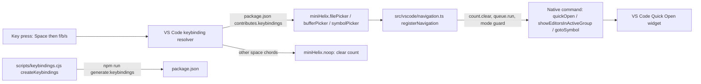

# Leader Pickers Specification

## Intent and Delivery Scope

- **Intent:** [intent.md](intent.md)
- **Outcome:** In NORMAL mode, Space then `f`, `b`, or `s` opens a native VS Code picker for files, editors in the active group, or symbols in the current file.
- **Includes:**
  - Space then `f` opens the workspace file picker.
  - Space then `b` opens the picker of editors in the active editor group.
  - Space then `s` opens the symbol picker for the current file.
  - The keys work in writable and read-only text editors in NORMAL mode.
  - The keys do nothing in INSERT mode, in suspended mode, and outside text-editor focus.
  - A pending count is cleared. Unbound Space chords do nothing.
  - The README documents the keys.
- **Constraints:**
  - Leader key is Space, fixed, with no setting (user, intent "Constraints").
  - Only `f`, `b`, and `s` in this delivery (user, intent "Constraints").
  - Use native VS Code pickers, not a custom picker (user, intent "Constraints").
  - `b` lists only the active editor group, unlike Helix (user, intent "Constraints").
  - VS Code 1.85 or later (repository, `package.json` `engines.vscode`).
  - Keybindings come from `scripts/keybindings.cjs`; `npm run check:keybindings` rejects a stale manifest (repository).

## Functional Requirements

- **FR-1** — The system must open VS Code's file picker (`workbench.action.quickOpen`) when the user presses Space then `f` in NORMAL mode.
  - Selection: included
  - Source: user (intent "Problem" and "Definition of done")
  - Verification: In NORMAL mode, press Space then `f`. The Quick Open widget becomes visible with an empty input. The document text does not change.

- **FR-2** — The system must open VS Code's picker of editors in the active group (`workbench.action.showEditorsInActiveGroup`) when the user presses Space then `b` in NORMAL mode.
  - Selection: included
  - Source: user (intent "Problem", "Definition of done", and "Constraints")
  - Verification: In NORMAL mode, press Space then `b`. The Quick Open widget becomes visible and its input starts with `edt active `.

- **FR-3** — The system must open VS Code's symbol picker for the current file (`workbench.action.gotoSymbol`) when the user presses Space then `s` in NORMAL mode.
  - Selection: included
  - Source: user (intent "Problem" and "Definition of done")
  - Verification: In NORMAL mode, press Space then `s`. The Quick Open widget becomes visible and its input starts with `@`.

- **FR-4** — The system must run the three leader commands in read-only text editors in NORMAL mode, as for `gd` and `gr`.
  - Selection: included
  - Source: user (intent "Definition of done"); repository precedent `scripts/keybindings.cjs:idleMotionWhen`
  - Verification: Repeat the FR-1 to FR-3 checks in a read-only document. Each picker opens.

- **FR-5** — The system must not open a picker from a leader command in INSERT mode, in suspended mode, or without an active text editor.
  - Selection: included
  - Source: intent "Definition of done" (proposed, matches the rest of the extension); repository precedent `src/vscode/navigation.ts:registerNavigation`
  - Recommendation: Recommended mandatory
  - Reason: The extension keeps native input outside NORMAL. Without this guard, a Command Palette call in INSERT mode would act like NORMAL.
  - Verification: Run each leader command from the extension host in INSERT mode and in suspended mode. No Quick Open widget becomes visible.

- **FR-6** — The system must clear a pending count when a leader command runs, and open the picker once.
  - Selection: included
  - Source: intent "Open questions" 1 (proposed); repository precedent `registerNavigation` calls `count.clear()`
  - Recommendation: Recommended mandatory
  - Reason: Every other key clears a count. Without this, the count would apply to a later, unrelated key.
  - Verification: Press `3`, Space, `f`. The Quick Open widget opens once. Close it with Escape and press `w`. The selection covers one word, not three.

- **FR-7** — The system must treat Space followed by any other bindable key as an unbound key: no text, no command, and a cleared count.
  - Selection: included
  - Source: intent "Open questions" 2 and 4 (proposed); repository precedent `scripts/keybindings.cjs:chordNoops`
  - Recommendation: Recommended mandatory
  - Reason: Space is blocked in NORMAL today. Without chord blockers, Space then a key could type text or leave a count pending.
  - Verification: Press Space then `x`, then Space then Enter. The document text does not change, and a pending count clears.

- **FR-8** — The system must keep the existing Space behavior while `gw` labels are visible or an `mr` replacement is pending: Space cancels them.
  - Selection: included
  - Source: repository precedent (`jumpWhen` and `surroundPendingWhen` bindings in `scripts/keybindings.cjs`); intent "Affected users and systems"
  - Recommendation: Recommended mandatory
  - Reason: A leader chord during these states would break existing `gw` and `mr` behavior.
  - Verification: Unit test: every `space *` binding uses the idle condition, which excludes `miniHelix.wordJumpActive` and `miniHelix.surroundReplacePending`. The single-key `space` bindings stay `miniHelix.noop`, `miniHelix.cancelWordJump`, and `miniHelix.cancelSurroundReplace`.

## Non-Functional Requirements

- **NFR-1** (compatibility) — The system must use only native command IDs that exist in VS Code 1.85.0 and add no dependency.
  - Selection: included
  - Source: repository `package.json` `engines.vscode`; external evidence below
  - Recommendation: Recommended mandatory
  - Reason: The extension states VS Code 1.85+ support. A newer command ID would fail on older supported versions.
  - Verification: Confirmed on 2026-10-26 in VS Code 1.85.0 source: `workbench.action.quickOpen` (`src/vs/workbench/browser/actions/quickAccessActions.ts`), `workbench.action.showEditorsInActiveGroup` (`src/vs/workbench/browser/parts/editor/editorActions.ts`), and `workbench.action.gotoSymbol` (`src/vs/workbench/contrib/codeEditor/browser/quickaccess/gotoSymbolQuickAccess.ts`), at `https://raw.githubusercontent.com/microsoft/vscode/1.85.0/<path>`. `package.json` dependencies stay unchanged.

- **NFR-2** (documentation) — The README must document Space `f`, `b`, and `s`, and must not state that Space is blocked without the chord exception.
  - Selection: included
  - Source: intent "Definition of done" (proposed); repository convention: `README.md` documents every binding, and its "What this version does" section lists Space as blocked
  - Recommendation: Recommended mandatory
  - Reason: Without this, the README gives incorrect information about Space.
  - Verification: Read `README.md`. It lists the three keys with their native pickers, the read-only and count rules, and the unbound-chord rule.

## Excluded and Deferred Requirements

- **FR-9** — Space then Shift+`s` opens workspace symbols (Helix `Space S`).
  - Selection: deferred
  - Source: intent "Open questions" 3
  - Recommendation: Optional
  - Verification: Space then Shift+`s` opens the `#` picker.
  - Decision: The user limited scope to `f`, `b`, and `s`.
  - Consequence: Space then Shift+`s` is an unbound chord (FR-7).

- **FR-10** — Other Helix Space keys (`F`, `j`, `/`, `y`, `p`, and others).
  - Selection: deferred
  - Source: intent "Open questions" 4
  - Recommendation: Optional
  - Verification: Each key opens its Helix-equivalent action.
  - Decision: The user adds leader keys later, one at a time.
  - Consequence: These keys are unbound chords (FR-7).

- **FR-11** — A setting to change the leader key.
  - Selection: excluded
  - Source: user (intent "Constraints")
  - Verification: A setting changes the leader key.
  - Decision: The user chose a fixed Space leader. Users can rebind through VS Code keybindings.
  - Consequence: No new configuration contract.

- **FR-12** — User-defined leader mappings or a leader menu.
  - Selection: excluded
  - Source: user (intent "Constraints")
  - Verification: A user mapping or menu entry runs a command.
  - Decision: The user chose a fixed set of keys.
  - Consequence: No new configuration contract or UI.

- **FR-13** — A custom Helix-style picker with preview.
  - Selection: excluded
  - Source: user (intent "Constraints")
  - Verification: A custom picker opens.
  - Decision: The user chose native pickers.
  - Consequence: Picker behavior and appearance are VS Code's.

## Framed Ledger

| Category | Status | Decision or section reference | Open issue or omission reason |
|---|---|---|---|
| UI | not applicable | — | The change adds no screen, control, or state. It opens existing native Quick Open pickers. VS Code shows its own chord message in the status bar. Command Palette titles are in Contracts. |
| Architecture (HLD) | approved | [Architecture (HLD)](#architecture-hld) | none |
| Models | not applicable | — | The change adds no data structure. The command map reuses `Record<string, string>` in `src/vscode/navigation.ts:navigationCommands`. |
| Contracts | drafted | [Contracts](#contracts) | none |
| Functions | drafted | [Functions](#functions) | none |
| Interfaces or Classes | not applicable | — | No new interface or class. The existing `registerNavigation` signature is unchanged. |
| Behavior | drafted | [Behavior](#behavior) | none |
| Failure Model | drafted | [Failure Model](#failure-model) | none |
| Traceability | drafted | [Traceability](#traceability) | none |

### Approval Records

- **Scope** — FR-1 to FR-8 and NFR-1 to NFR-2 included; FR-9 and FR-10 deferred; FR-11 to FR-13 excluded.
  - Evidence: `/quickie` invocation on 2026-10-26, after the user answered the intent questions in this session.
  - Delegation: Quickie limited delegation for routine scope, UI, HLD, specification, and plan approvals. The user did not review this specification directly.
  - Validity: current

- **UI** — Marked not applicable; no new UI.
  - Evidence: `/quickie` invocation on 2026-10-26.
  - Delegation: Same limits as Scope.
  - Validity: current

- **HLD** — Extend the existing navigation delegation table and the keybinding generator. No new component.
  - Evidence: `/quickie` invocation on 2026-10-26.
  - Delegation: Same limits as Scope.
  - Validity: current

- **Specification** — Complete specification validated after all review checks passed.
  - Evidence: `/quickie` invocation on 2026-10-26.
  - Delegation: Same limits as Scope. Not a direct user review.
  - Validity: current

## Architecture (HLD)

### Architecture Decisions

- **Reuse the navigation delegation table** — Add three entries to `src/vscode/navigation.ts:navigationCommands`. `registerNavigation` already clears the count, uses the command queue, and checks mode, enabled state, and active editor (FR-5, FR-6).
  - Alternative: A new `src/vscode/leader.ts` module. It would copy the same guard and add no behavior.
- **Bind leader keys as VS Code chords** — Generate `space f`, `space b`, and `space s` in `scripts/keybindings.cjs`, as for `g d` and `g r`. Generate `chordNoops('space', ['f', 'b', 's'])` for every other key (FR-7).
  - Alternative: A pending-leader state in the extension, as for counts. It adds a context key and state for no present need.
- **Use the idle condition** — The leader bindings use `idleMotionWhen`. It permits read-only editors (FR-4) and excludes `gw` labels and pending `mr` (FR-8).
- **Native pickers** — Delegate to `workbench.action.quickOpen`, `workbench.action.showEditorsInActiveGroup`, and `workbench.action.gotoSymbol` (user choice, NFR-1).

### Components

- **Keybinding generator** — modified
  - Evidence: `scripts/keybindings.cjs:createKeybindings`, `chordNoops`
  - Responsibility: Generate the three leader bindings and the Space chord blockers.
  - Boundaries: Output goes to `package.json` `contributes.keybindings`, checked by `npm run check:keybindings`.
- **Extension manifest** — modified
  - Evidence: `package.json` `contributes.commands`, `contributes.keybindings`
  - Responsibility: Declare the three commands and the generated bindings.
  - Boundaries: Public contract to VS Code and to users' `keybindings.json`.
- **Navigation delegation** — modified
  - Evidence: `src/vscode/navigation.ts:navigationCommands`, `registerNavigation`
  - Responsibility: Map each leader command to its native picker command, with the existing guard.
  - Boundaries: Calls VS Code `commands.executeCommand`; owns no state.
- **Mode, count, and queue** — unchanged
  - Evidence: `src/core/mode.ts:ModeController`, `src/core/count.ts:Count`, `src/vscode/queue.ts:CommandQueue`
  - Responsibility: Existing mode state, count state, and command order.
- **README** — modified
  - Evidence: `README.md`
  - Responsibility: User documentation (NFR-2).

### Architectural Flow

- The user presses Space in NORMAL mode with text-editor focus. VS Code enters chord mode because `space *` bindings match.
- The user presses `f`, `b`, or `s`. VS Code runs the bound `miniHelix.*Picker` command.
- `registerNavigation` clears the count. In the queue, it checks the mode, enabled state, and active editor, then runs the native command.
- VS Code shows its Quick Open widget. Focus moves to the widget, so Mini Helix bindings stop matching until the widget closes.
- Any other second key runs `miniHelix.noop`, which clears the count.

### Constraints and Assumptions

- Native command IDs exist in VS Code 1.85.0 (verified, see NFR-1) and in the local test build 1.143.1 (verified by search of `.vscode-test/vscode-linux-x64-1.143.1`).
- `workbench.action.quickOpen` with empty input shows recently opened files first. Typing searches workspace files. With no workspace folder, it lists only open and recent files. This is accepted native behavior (user chose native pickers).
- VS Code shows its own "waiting for second key of chord" status message after Space. The `g` and `m` chords show the same message today.
- No deployment, cost, or recovery decision applies. The change is reversible by removing the bindings.

## Contracts

### Leader commands

- **Owner:** Extension manifest and navigation delegation
- **Definition:** New entries in `package.json` `contributes.commands`, in the same format as `miniHelix.gotoDefinition`:

| Command | Title | Native command |
|---|---|---|
| `miniHelix.filePicker` | `Open File Picker (Space f)` | `workbench.action.quickOpen` |
| `miniHelix.bufferPicker` | `Open Buffer Picker (Space b)` | `workbench.action.showEditorsInActiveGroup` |
| `miniHelix.symbolPicker` | `Open Symbol Picker (Space s)` | `workbench.action.gotoSymbol` |

- **Producers:** `package.json`; `src/vscode/navigation.ts:navigationCommands`
- **Consumers:** VS Code keybinding resolver, Command Palette, user `keybindings.json`
- **Version and compatibility:** Additive. Category `Mini Helix`; enablement `miniHelix.enabled && miniHelix.mode == normal`, as for `gd`.
- **Validation:** The runtime guard in `registerNavigation` (FR-5).
- **Invariants:** Each command ID appears in `contributes.commands`, in `navigationCommands`, and in at least one keybinding.

### Leader keybindings

- **Owner:** Keybinding generator
- **Definition:** Generated entries in `package.json` `contributes.keybindings`:
  - `space f`, `space b`, `space s` → the leader commands, `when` = `idleMotionWhen`.
  - `space <key>` → `miniHelix.noop`, `when` = `idleMotionWhen`, for every key in `blocked`, `escape`, and `navigationKeys`, except `f`, `b`, `s`.
- **Producers:** `scripts/keybindings.cjs:createKeybindings`
- **Consumers:** VS Code; `test/unit/keybindings.test.ts`
- **Version and compatibility:** Additive. The single-key `space` bindings (`miniHelix.noop`, `miniHelix.cancelWordJump`, `miniHelix.cancelSurroundReplace`) stay unchanged.
- **Validation:** `npm run check:keybindings` fails when the manifest differs from the generator.
- **Invariants:** No `space *` binding uses a modifier other than the existing `shift+<key>` second keys. Every `space *` binding excludes `miniHelix.wordJumpActive` and `miniHelix.surroundReplacePending`.

## Functions

### Navigation delegation

- **Entry point:** `src/vscode/navigation.ts:registerNavigation` (existing; unchanged signature)
- **Inputs:** Command call with no arguments, from a keybinding or the Command Palette.
- **Effects and outputs:** Clears the count. In the command queue, if `modes.current.enabled`, `modes.current.mode === 'normal'`, and an active text editor exists, runs the mapped native command. Otherwise, does nothing.
- **Errors:** See [Failure Model](#failure-model).

### Keybinding generator

- **Entry point:** `scripts/keybindings.cjs:createKeybindings` (existing)
- **Inputs:** None.
- **Effects and outputs:** Returns the binding list with the leader bindings and Space chord blockers added. Exported constants may expose the leader list for tests.
- **Errors:** None at run time. `--check` sets exit code 1 for a stale manifest.

## Behavior

### Leader key in NORMAL mode

- **Condition:** NORMAL mode, Mini Helix enabled, text-editor focus, no `gw` labels, no pending `mr`.
- **Steps:**
  1. Space starts a VS Code chord.
  2. `f`, `b`, or `s` runs the leader command. Another key runs `miniHelix.noop`.
  3. The leader command clears the count, then opens the native picker in the queue.
- **Result:** The picker is visible, the document is unchanged, and no count is pending. Mode stays NORMAL.

### Leader key outside NORMAL

- **Condition:** INSERT mode, suspended mode, or focus outside a text editor.
- **Steps:** No `space *` binding matches. Space keeps its native effect (for example, it types a space in INSERT).
- **Result:** No picker opens from the leader keys.

### Leader key during `gw` or `mr`

- **Condition:** `miniHelix.wordJumpActive` or `miniHelix.surroundReplacePending` is true.
- **Steps:** No `space *` binding matches. The existing single-key `space` bindings cancel the `gw` labels or the pending `mr` replacement.
- **Result:** Existing behavior stays unchanged.

## Failure Model

- **F-1** — A leader command runs from the Command Palette in INSERT mode or suspended mode.
  - Owner: Navigation delegation
  - Detector: Mode and enabled check in `registerNavigation`.
  - Response: Do nothing, except clear the count.
  - Verification: Integration check (FR-5): no Quick Open widget becomes visible.
- **F-2** — No active text editor when the command runs.
  - Owner: Navigation delegation
  - Detector: `vscode.window.activeTextEditor` check in `registerNavigation`.
  - Response: Do nothing.
  - Verification: Covered by the existing guard; integration check (FR-5).
- **F-3** — No symbol provider for the current language.
  - Owner: VS Code
  - Detector: Native symbol picker.
  - Response: VS Code shows its own empty-state message in the picker.
  - Verification: Accepted native behavior; not tested.
- **F-4** — Generated bindings drift from `package.json`.
  - Owner: Keybinding generator
  - Detector: `npm run check:keybindings` in `npm test` and `vscode:prepublish`.
  - Response: The check fails with "Generated keybindings are stale".
  - Verification: `npm test` passes only with a regenerated manifest.

## Traceability

- **FR-1** → Contracts "Leader commands" (`miniHelix.filePicker`), "Leader keybindings" (`space f`), Functions "Navigation delegation"
  - Verification: FR-1 verification (integration, real keys)
- **FR-2** → Contracts (`miniHelix.bufferPicker`, `space b`), Functions "Navigation delegation"
  - Verification: FR-2 verification (integration, real keys)
- **FR-3** → Contracts (`miniHelix.symbolPicker`, `space s`), Functions "Navigation delegation"
  - Verification: FR-3 verification (integration, real keys)
- **FR-4** → Architecture Decision "Use the idle condition"; Contracts "Leader keybindings"
  - Verification: FR-4 verification (integration in a read-only document); unit test of `when` conditions
- **FR-5** → Functions "Navigation delegation"; Behavior "Leader key outside NORMAL"; F-1, F-2
  - Verification: FR-5 verification (integration guard check)
- **FR-6** → Functions "Navigation delegation"; Behavior "Leader key in NORMAL mode"
  - Verification: FR-6 verification (integration, real keys)
- **FR-7** → Contracts "Leader keybindings" (chord blockers)
  - Verification: FR-7 verification (unit test of chord set; integration key check)
- **FR-8** → Contracts "Leader keybindings" invariants; Behavior "Leader key during `gw` or `mr`"
  - Verification: FR-8 verification (unit test)
- **NFR-1** → Architecture Decision "Native pickers"; Constraints and Assumptions
  - Verification: NFR-1 verification (source check recorded; `package.json` dependencies unchanged)
- **NFR-2** → Component "README"
  - Verification: NFR-2 verification (README review)

## Open Issues

- **Quick Open shows recent files first** — VS Code native behavior for `workbench.action.quickOpen`.
  - Blocks: none
  - Resolution: Accepted. The user chose native pickers. The README states the native behavior.
