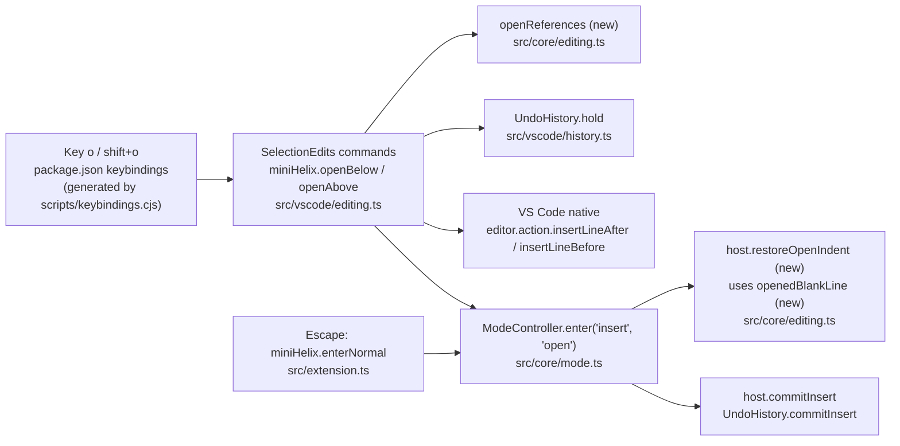

# Open Line Specification

## Intent and Delivery Scope

- **Intent:** [intent.md](intent.md)
- **Outcome:** In NORMAL mode, `o` opens a new line below each selection and `O` opens a new line above each selection. Then the mode changes to INSERT. The behavior matches pinned Helix `ba40e547426b0f9896c8bdc699a4ab11f2b37dbc`, except for two planned differences.
- **Includes:**
  - `o` and `O` keys and their commands.
  - Helix line selection rule for each selection, multiple selections, and edge lines.
  - Count is ignored (planned difference).
  - Indentation from VS Code's native line commands (planned difference).
  - Helix whitespace removal when INSERT ends directly after `o` or `O`.
  - One undo revision for the opened line and the INSERT session.
  - README documentation.
- **Constraints:**
  - Match pinned Helix, except count and indentation. Source: user, intent.
  - Comment continuation is out of scope. Source: user, intent.
  - `c` keeps its Helix fallback indentation. Source: user, intent.
  - No parser, no tree-sitter, no global `type` override. Source: README "What this version does".
  - `package.json` keybindings come from `scripts/keybindings.cjs`. `npm test` fails when they differ. Source: `scripts/keybindings.cjs`, `package.json` script `check:keybindings`.
  - The project tests with the US keyboard layout. Source: README "Initial limitations".

### Resolution of intent open questions

| Intent question | Resolution | Evidence |
|---|---|---|
| 1. Undo grouping | One revision, as in Helix. This is FR-9. | Helix `enter_normal_mode` commits after the INSERT session. `src/vscode/editing.ts:SelectionEdits.run` already holds `a` and `c` edits with their INSERT. |
| 2. VS Code indent source | Native commands `editor.action.insertLineAfter` and `editor.action.insertLineBefore`. See the Architecture Decisions. | VS Code 1.143.1 `lineInsertAfter` and `lineInsertBefore` call `_enter`, which applies `editor.autoIndent`, `onEnterRules`, and `indentationRules`. The extension API has no getter for language indent rules. |
| 3. Escape after `o` with nothing typed | Helix removes the whitespace on the new line. This is FR-8. | Helix `helix-view/src/editor.rs:try_restore_indent` at the pinned revision. |
| 4. Upstream tests and oracle | Unit tests use expected values from the pinned Helix source. The oracle is excluded. See NFR-3 and the excluded list. | `scripts/helix-line-oracle.cjs` covers only line selection. |
| 5. Comment continuation in pinned Helix | It exists and it is on by default. It stays out of scope. | Pinned `helix-term/src/commands.rs:open` and `helix-view/src/editor.rs` (`continue_comments: true`). |

## Functional Requirements

- **FR-1** — In NORMAL mode, `o` must open one new line below the line of the last character of each selection. Each new line gets a caret after its indentation, and the mode changes to INSERT.
  - Selection: included
  - Source: user ("match pinned Helix"); pinned Helix `open` with `Open::Below` uses `prev_grapheme_boundary(text, range.to())`.
  - Verification: Integration test. Text `one\ntwo\n`, selection `o` to `w` (offsets 0 to 6). Press `o`. The text is `one\ntwo\n\n`, the caret is at offset 8, and the mode is INSERT.

- **FR-2** — In NORMAL mode, `O` must open one new line above the line of the first character of each selection. Each new line gets a caret after its indentation, and the mode changes to INSERT.
  - Selection: included
  - Source: user; pinned Helix `open` with `Open::Above` uses `range.from()`.
  - Verification: Integration test. Text `one\ntwo\n`, selection offsets 2 to 6. Press `O`. The text is `\none\ntwo\n`, the caret is at offset 0, and the mode is INSERT.

- **FR-3** — An empty VS Code selection must count as Helix's block cursor. `o` and `O` must use the line of the character under the caret. A caret at the end of a text that ends with a line ending uses the line before the last, empty line.
  - Selection: included
  - Source: Recommended mandatory inference from FR-1, FR-2, and `src/core/editing.ts:blockRange`.
  - Recommendation: Recommended mandatory
  - Reason: Without it, a caret at a line end or at the end of the text opens a line in a different place than Helix.
  - Verification: Unit test of the reference-caret function with Helix notation. Example: `abc\n` with a caret at offset 4 and `o` gives a reference on line 0.

- **FR-4** — Each selection must open its own line, also when two selections are on the same line. Each new line gets one caret. The primary selection stays primary.
  - Selection: included
  - Source: user (Helix parity); pinned Helix `open` makes one change and one cursor per range.
  - Verification: Integration test. Text `ab\ncd\n`, carets at offsets 0 and 1. Press `o`. The text is `ab\n\n\ncd\n` and the carets are at offsets 3 and 4.

- **FR-5** — A count before `o` or `O` must have no effect. The key must clear the count. `3o` opens one line for each selection.
  - Selection: included
  - Source: user (planned difference from Helix).
  - Verification: Integration test. Type `3o` on a one-line text. Exactly one line is added. The status bar shows no pending count.

- **FR-6** — The indentation of a new line must be the indentation that VS Code's native "Insert Line Below" and "Insert Line Above" commands give. This follows `editor.autoIndent` and the language configuration of the document.
  - Selection: included
  - Source: user (planned difference from Helix).
  - Verification: Integration test. The test sets a language rule that indents after a line that ends with `{`, with `vscode.languages.setLanguageConfiguration`. The suite does not depend on built-in language extensions (`test/integration/navigation.ts`). Document `if (a) {\n}\n`, 4-space indent, caret on line 0. Press `o`. The new line is `    ` and the caret is after it. With `editor.autoIndent` set to `none`, the new line is empty.

- **FR-7** — Each new line must use the document's line ending.
  - Selection: included
  - Source: user (Helix parity uses `doc.line_ending`).
  - Verification: Integration test on a CRLF document. After `o`, the text contains only `\r\n` line endings.

- **FR-8** — When INSERT ends directly after `o` or `O`, Mini Helix must remove the whitespace before the caret on its line, if all of these are true:
  - there is exactly one selection;
  - the session's net change is one insertion that ends at the caret;
  - that insertion starts with a line ending and contains only whitespace after it;
  - the caret is at the end of its line.
  - Selection: included
  - Source: user (Helix parity); pinned Helix `helix-view/src/editor.rs:try_restore_indent`.
  - Verification: Integration test. Indented line, press `o`, then Escape. The new line is empty. Repeat, but type `x` before Escape. The indentation stays.

- **FR-9** — One `u` after `o` or `O`, the INSERT session, and Escape must restore the text before the `o` or `O` key. This includes the FR-8 removal.
  - Selection: included
  - Source: user (Helix parity); repository precedent in `src/vscode/editing.ts:SelectionEdits.run` for `a` and `c`.
  - Verification: Integration test. Press `o`, type `xy`, press Escape, press `u`. The text is equal to the text before `o`.

- **FR-10** — In a read-only editor, `o` and `O` must not edit or change the mode. They keep the existing blocker behavior.
  - Selection: included
  - Source: Recommended mandatory inference. Repository precedent: `a`, `c`, and `d` use `normalWhen`, which has `!editorReadonly`.
  - Recommendation: Recommended mandatory
  - Reason: An edit key in a read-only editor must not enter INSERT. Without this rule, `o` differs from `a`, `c`, and `d`.
  - Verification: Unit test. The `o` and `shift+o` bindings use a `when` clause that contains `!editorReadonly`.

- **FR-11** — While a word jump is active, `o` must stay label input. While `mr` waits for its replacement, `o` and `O` must stay replacement input.
  - Selection: included
  - Source: Repository constraint. `scripts/keybindings.cjs:createKeybindings` puts label and replacement input after the edit keys.
  - Verification: Unit test. The bindings for `o` are, in order, `miniHelix.noop`, `miniHelix.openBelow`, `miniHelix.wordJumpInput`, `miniHelix.surroundReplaceInput`. The same order applies to `shift+o` with `miniHelix.openAbove`, except that `shift+o` cancels the word jump.

- **FR-12** — The README must document `o` and `O`. This includes the key table, the list of unblocked keys, the count rules, the command table, and the two planned differences. It also includes comment continuation as a known difference.
  - Selection: included
  - Source: intent "Definition of done" item 7; repository precedent for every key.
  - Verification: Read `README.md`. Each listed item is present.

## Non-Functional Requirements

- **NFR-1** (compatibility) — `npm test` must pass. This includes the keybinding check.
  - Selection: included
  - Source: intent "Definition of done" item 8.
  - Verification: Run `npm test`. The exit code is 0.

- **NFR-2** (compatibility) — `npm run test:integration` must pass with the new `o` and `O` cases.
  - Selection: included
  - Source: Recommended mandatory inference. FR-4, FR-6, FR-7, FR-8, and FR-9 depend on native VS Code behavior, which unit tests cannot run.
  - Recommendation: Recommended mandatory
  - Reason: Without it, the native-command behavior has no automated check.
  - Verification: Run `npm run test:integration`. The output shows `PASS` for the editing check and the exit code is 0.

- **NFR-3** (maintainability) — Unit tests for the pure functions must use expected values derived from the pinned Helix source. Each test group must cite the Helix function.
  - Selection: included
  - Source: Recommended mandatory inference. Repository precedent: `test/unit/editing.test.ts` cites Helix functions and tests.
  - Recommendation: Recommended mandatory
  - Reason: Without it, parity claims have no traceable reference.
  - Verification: Read the new tests. Each group names `open` or `try_restore_indent` from Helix `ba40e547`.

## Excluded and Deferred Requirements

- **FR-X1** — A count `n` opens `n` lines for each selection, with one caret on each line.
  - Selection: excluded
  - Source: Helix `open` (`text.repeat(count)`).
  - Decision: User decision in the intent conversation: "Yes, ignore it".
  - Consequence: `3o` differs from Helix. The README states this.

- **FR-X2** — Indentation from Helix's fallback (`indent_for_newline` without tree-sitter).
  - Selection: excluded
  - Source: Helix `open`.
  - Decision: User decision: "VS Code's language rules", confirmed as a planned difference.
  - Consequence: Helix comparison tests do not compare indentation. `O` on the first line has no indentation, because VS Code inserts only a line ending there.

- **FR-X3** — Comment continuation: the new line starts with the comment token of the current line.
  - Selection: excluded
  - Source: Helix `open` with `continue_comments`.
  - Decision: User decision: "Out of scope".
  - Consequence: `o` on a `//` line does not add `// `. VS Code's own `onEnterRules` can still add text, for example ` * ` in a JSDoc block. That text comes from the FR-6 choice, not from Mini Helix.

- **FR-X4** — The FR-8 whitespace removal also when INSERT ends after `i`, `a`, or `c`.
  - Selection: deferred
  - Source: Helix `try_restore_indent` runs for every INSERT exit.
  - Recommendation: Optional
  - Verification: `a`, Enter, Escape on an indented line leaves an empty line.
  - Decision: Delegated auto mode excludes optional scope. The request names only `o` and `O`.
  - Consequence: `a` followed by Enter and Escape keeps the auto-indent, as today.

- **NFR-X1** — Extend the Helix oracle (`scripts/helix-line-oracle.cjs`) to generate `o` and `O` cases.
  - Selection: excluded
  - Source: Intent open question 4.
  - Recommendation: Optional
  - Verification: The generated corpus matches the extension for `o` and `O` cases.
  - Decision: Delegated auto mode excludes optional scope. The oracle output includes indentation, which differs by design (FR-6).
  - Consequence: Parity relies on source-derived unit tests and integration tests, not on machine-generated Helix output.

## Framed Ledger

| Category | Status | Decision or section reference | Open issue or omission reason |
|---|---|---|---|
| UI | not applicable | — | No screen, view, or visual state changes. The existing mode indicator shows INSERT. The two commands appear in the Command Palette through the existing contribution pattern (see Contracts). |
| Architecture (HLD) | approved | [Architecture (HLD)](#architecture-hld) | None |
| Models | drafted | [Models](#models) | None |
| Contracts | drafted | [Contracts](#contracts) | None |
| Functions | drafted | [Functions](#functions) | None |
| Interfaces or Classes | drafted | [Interfaces or Classes](#interfaces-or-classes) | None |
| Behavior | drafted | [Behavior](#behavior) | None |
| Failure Model | drafted | [Failure Model](#failure-model) | None |
| Traceability | drafted | [Traceability](#traceability) | None |

### Approval Records

- **Scope** — FR-1 to FR-12 and NFR-1 to NFR-3 are included. FR-X1 to FR-X3 and NFR-X1 are excluded. FR-X4 is deferred.
  - Evidence: `/quickie` invocation on 2026-10-24. User decisions on count, indentation, and comment continuation were made in the intent conversation on 2026-10-24.
  - Delegation: Limited quickie delegation for routine scope approval. The user did not review this list directly.
  - Validity: current
- **UI** — Not applicable. No UI is added or changed.
  - Evidence: `/quickie` invocation on 2026-10-24.
  - Delegation: Limited quickie delegation for routine UI decisions.
  - Validity: current
- **Architecture (HLD)** — Native VS Code line commands, a new pure reference-caret function, a new pure whitespace-removal function, and an `open` INSERT entry in the mode controller.
  - Evidence: `/quickie` invocation on 2026-10-24.
  - Delegation: Limited quickie delegation for routine HLD approval. The design uses the indentation source the user chose. The user did not review the HLD directly.
  - Validity: current
- **Specification** — All checks in the review passed. Status set to `validated`.
  - Evidence: `/quickie` invocation on 2026-10-24.
  - Delegation: Limited quickie delegation. This is not a direct user review.
  - Validity: current

## Architecture (HLD)

### Architecture Decisions

- **Use the native commands `editor.action.insertLineAfter` (`o`) and `editor.action.insertLineBefore` (`O`) to insert the lines.** — Source: the user chose VS Code's language indent rules (FR-6).
  - Evidence: In VS Code 1.143.1, `lineInsertAfter` and `lineInsertBefore` call `_enter` for each selection. `_enter` applies `editor.autoIndent`, `onEnterRules`, and `indentationRules`. The VS Code extension API (`vscode.languages`) has `setLanguageConfiguration`, but no getter for these rules (https://code.visualstudio.com/api/references/vscode-api#languages, checked 2026-10-24).
  - Alternative: Compute the indentation in the extension. This needs the language rules, which the API does not expose. It would copy VS Code logic and still differ from it.
  - Reuse check: This reuses a native capability. It adds no dependency.
- **Place one caret per selection on its Helix reference line before the native command runs.** — The native commands use each selection's head line (`positionLineNumber`), not Helix's `to()` or `from()`.
  - Evidence: VS Code 1.143.1 `lineInsertAfter` reads `t[n].positionLineNumber`.
  - Alternative: Pass the selections unchanged. A reversed or multi-line selection then opens on the wrong line.
- **Put each reference caret at a distinct offset: the start of the selection's last character (`o`) or the selection start (`O`).** — Two selections on one line must keep two carets, so that VS Code makes two lines (FR-4).
  - Evidence: VS Code merges equal carets. `_getLoserCursorMap` drops a command only when ranges overlap strictly. Two empty ranges at the same line end do not overlap, so both lines are inserted.
- **Add an INSERT entry `open` to the mode controller.** — FR-8 must run when INSERT ends, before the revision is committed, as `restoreAppendCursor` does for `a`.
  - Evidence: `src/core/mode.ts:ModeController.enter` calls `restoreAppendCursor` before `commitInsert`.



### Components

- **Keybinding generator** — modified
  - Evidence: `scripts/keybindings.cjs:edits`, `scripts/keybindings.cjs:createKeybindings`
  - Responsibility: Bind `o` to `miniHelix.openBelow` and `shift+o` to `miniHelix.openAbove` with `normalWhen`, in the same position as the other edit keys.
  - Boundaries: Writes `package.json` `contributes.keybindings`.
- **Extension manifest** — modified
  - Evidence: `package.json` `contributes.commands`, `contributes.keybindings`
  - Responsibility: Contribute the two commands. Hold the generated keybindings.
  - Boundaries: Public contract with VS Code and with user keybindings.
- **Editing core** — modified
  - Evidence: `src/core/editing.ts` (`blockRange`, `append`, `changeSelection`)
  - Responsibility: Pure functions `openReferences` (FR-1 to FR-4) and `openedBlankLine` (FR-8).
  - Boundaries: No `vscode` import. Uses UTF-16 offsets and `WordMotionText`.
- **Selection edits adapter** — modified
  - Evidence: `src/vscode/editing.ts:SelectionEdits`
  - Responsibility: Register the two commands, clear the count, hold the revision, place the reference carets, run the native command, and enter INSERT with the `open` entry. Remember the text before the edit for FR-8. Apply the FR-8 removal when the mode controller asks for it.
  - Boundaries: The only component that calls the native line commands.
- **Mode controller** — modified
  - Evidence: `src/core/mode.ts:ModeController`, `src/core/mode.ts:InsertEntry`, `src/core/mode.ts:ModeHost`
  - Responsibility: Track an `open` INSERT. When that INSERT ends, call the host's open-restore hook before `commitInsert`.
  - Boundaries: No `vscode` import.
- **Extension entry** — modified
  - Evidence: `src/extension.ts:activate`
  - Responsibility: Connect the new `ModeHost` hook to `SelectionEdits`.
- **Undo history** — unchanged
  - Evidence: `src/vscode/history.ts:UndoHistory.hold`, `UndoHistory.commitInsert`
  - Responsibility: Group the native insertion, the typed text, and the FR-8 removal into one revision.
- **VS Code native line commands** — unchanged, external
  - Evidence: VS Code `editor.action.insertLineAfter`, `editor.action.insertLineBefore`
  - Responsibility: Insert the lines with VS Code indentation and place the carets.

### Architectural Flow

- The user presses `o` in NORMAL mode in a writable editor. VS Code runs `miniHelix.openBelow`.
- `SelectionEdits` clears the count and queues the work on the shared `CommandQueue`.
- It reads the selections, calls `openReferences`, and holds the revision in `UndoHistory`.
- It sets one caret per reference, runs `editor.action.insertLineAfter`, and enters INSERT with the `open` entry.
- The user types. The native typing changes the held revision.
- The user presses Escape. `ModeController.enter('normal')` calls the open-restore hook. `SelectionEdits` checks `openedBlankLine` and deletes the whitespace when it applies. Then `commitInsert` ends the revision.

### Constraints and Assumptions

- The integration host uses `editor.multiCursorMergeOverlapping: false` (`test/runIntegration.ts`). Distinct reference carets do not overlap, so the default setting gives the same result for FR-4. Verification status: covered by the FR-4 integration test.
- Assumption: The VS Code text model converts the `\n` that `_enter` inserts to the document's line ending. Verification status: unverified; the FR-7 integration test checks it.
- `O` on line 1 inserts only a line ending (VS Code `lineInsertBefore`). The caret stays at offset 0, which is Helix's caret position. The new line has no indentation. This is part of the FR-6 difference.
- Compatibility: The change adds two commands and two key bindings. `o` and `O` are blocked today, so no existing behavior is lost.
- No deployment, cost, or recovery decisions apply. The change is local to the extension.

## Models

### `OffsetRange`

- **Owner:** Editing core
- **Definition:** Existing, `src/core/wordMotion.ts:OffsetRange`. The reference carets are empty `OffsetRange` values.
- **Invariants:** `openReferences` returns one caret per input selection, in input order, so index 0 stays primary.

### `InsertEntry`

- **Owner:** Mode controller
- **Definition:** Existing, `src/core/mode.ts:InsertEntry`. It must add the value `'open'`.

```ts
export type InsertEntry = 'insert' | 'append' | 'change' | 'open';
```

- **Invariants:** An `open` INSERT starts only from `miniHelix.openBelow` or `miniHelix.openAbove`.

## Contracts

### Contributed commands

- **Owner:** Extension manifest
- **Definition:** `package.json` `contributes.commands`, same pattern as `miniHelix.append`.
- **Producers:** `package.json`; registered in `src/vscode/editing.ts`.
- **Consumers:** VS Code keybindings, the Command Palette, and user keybindings.
- **Version and compatibility:** New ids `miniHelix.openBelow` (title "Open Line Below (o)") and `miniHelix.openAbove` (title "Open Line Above (O)"). Category `Mini Helix`. Enablement `miniHelix.enabled && miniHelix.mode == normal`. No existing id changes.
- **Validation:** The command does nothing when no editor is active, Mini Helix is disabled, or the mode is not NORMAL. This is the existing `SelectionEdits.run` guard.
- **Invariants:** Each bound command is contributed and registered. `test/unit/keybindings.test.ts` checks this.

### Generated keybindings

- **Owner:** Keybinding generator
- **Definition:** `scripts/keybindings.cjs:createKeybindings`
- **Producers:** `npm run generate:keybindings`
- **Consumers:** VS Code; `npm run check:keybindings`
- **Version and compatibility:** `o` and `shift+o` keep their blockers. The edit bindings come after the blockers and before label and replacement input.
- **Invariants:** `package.json` keybindings equal the generator output.

## Functions

### Editing core (`src/core/editing.ts`)

- **Entry point:** New `openReferences`.
- **Inputs:** Document text, the selections, and the direction (`below` or `above`).
- **Effects and outputs:** One caret per selection. For `below`: the start offset of the last grapheme of the block range (Helix `prev_grapheme_boundary(text, range.to())`), or 0 for an empty text. For `above`: the start of the block range (Helix `range.from()`).
- **Errors:** None. The function is total.

- **Entry point:** New `openedBlankLine`.
- **Inputs:** The text before the `o` or `O` edit, the text now, and the single caret offset.
- **Effects and outputs:** The range from the start of the caret's line to the caret, when the FR-8 conditions are true. Otherwise `undefined`.
- **Errors:** None. The function is total.

```ts
export function openReferences(
  text: WordMotionText, ranges: readonly OffsetRange[], direction: 'below' | 'above'
): OffsetRange[] { ... }

export function openedBlankLine(
  before: string, after: string, caret: number
): { readonly from: number; readonly to: number } | undefined { ... }
```

### Selection edits adapter (`src/vscode/editing.ts:SelectionEdits`)

- **Entry point:** Registered commands `miniHelix.openBelow` and `miniHelix.openAbove`.
- **Inputs:** The active editor and its selections.
- **Effects and outputs:** See the open flow in Behavior.
- **Errors:** See F-1 and F-2.

- **Entry point:** New method that `ModeHost` calls when an `open` INSERT ends.
- **Inputs:** The document and text saved by the open command, and the active editor.
- **Effects and outputs:** Deletes the range from `openedBlankLine`, if any. The deletion belongs to the held revision.
- **Errors:** See F-3.

## Interfaces or Classes

### `ModeHost`

- **Owner:** Mode controller
- **Responsibility and boundary:** Lets `ModeController` call VS Code work without a `vscode` import.
- **Provider and consumers:** Provided in `src/extension.ts:activate`. Called by `ModeController`.

```ts
export interface ModeHost {
  prepareInsert(): void;
  restoreAppendCursor(): void;
  /** An INSERT entered by `o` or `O` ended: remove its untouched indentation. */
  restoreOpenIndent(): void;
  commitInsert(): void;
  render(state: ModeState): void;
  publish(state: ModeState): Promise<void>;
}
```

- `ModeController.enter('normal')` must call `restoreOpenIndent` before `commitInsert` when the INSERT entry was `open`. `setEnabled(false)` must not call it, as it does not call `restoreAppendCursor`.

## Behavior

### Open flow (`o` or `O`)

- **Condition:** An active editor, Mini Helix enabled, NORMAL mode, writable document.
- **Steps:**
  1. Clear the count.
  2. Queue the work on the shared `CommandQueue`.
  3. Compute `openReferences` from the current selections.
  4. Save the document and its text. Hold the revision with `UndoHistory.hold`.
  5. Set the editor selections to the reference carets.
  6. Run `editor.action.insertLineAfter` for `o` or `editor.action.insertLineBefore` for `O`.
  7. If the document did not change, restore the original selections, commit the revision, and stop (F-1).
  8. Enter INSERT with the `open` entry.
- **Result:** One new line per selection, a caret after each line's indentation, INSERT mode.

### INSERT end after `o` or `O`

- **Condition:** INSERT entered with the `open` entry. The user presses Escape.
- **Steps:**
  1. `ModeController.enter('normal')` calls `restoreOpenIndent`.
  2. If the active editor shows the saved document and has exactly one selection, call `openedBlankLine` with the saved text, the current text, and the caret.
  3. If a range comes back, delete it.
  4. Clear the saved state.
  5. `commitInsert` ends the revision.
- **Result:** NORMAL mode. An untouched new line has no whitespace. One `u` restores the text before `o` or `O`.

## Failure Model

- **F-1** — The native command makes no change, for example because the document became read-only.
  - Owner: Selection edits adapter
  - Detector: The document version is unchanged after the native command.
  - Response: Restore the original selections, commit the held revision, stay in NORMAL.
  - Verification: Code review of the guard. A read-only editor has no `o` binding, so no key path reaches this case.
- **F-2** — Mini Helix is disabled, or the mode is not NORMAL, when the queued work runs.
  - Owner: Selection edits adapter
  - Detector: The existing `SelectionEdits.run` guard.
  - Response: Do nothing.
  - Verification: Existing guard pattern. No new test.
- **F-3** — The active editor at Escape is not the saved document, or the user switched documents during INSERT.
  - Owner: Selection edits adapter
  - Detector: The document comparison in `restoreOpenIndent`.
  - Response: Do not remove whitespace. Clear the saved state.
  - Verification: Unit test of `openedBlankLine` for the text conditions. Document comparison follows the `restoreAppendCursor` pattern.
- **F-4** — The user typed, moved the caret, or changed other text during INSERT.
  - Owner: Editing core
  - Detector: `openedBlankLine` conditions fail.
  - Response: Do not remove whitespace.
  - Verification: Unit tests for each failed condition.

## Traceability

- **FR-1** → Editing core `openReferences`; Open flow; native `insertLineAfter`
  - Verification: FR-1 integration test; `openReferences` unit tests
- **FR-2** → Editing core `openReferences`; Open flow; native `insertLineBefore`
  - Verification: FR-2 integration test; `openReferences` unit tests
- **FR-3** → Editing core `openReferences` with `blockRange`
  - Verification: `openReferences` unit tests
- **FR-4** → Architecture decision on distinct reference carets; Open flow
  - Verification: FR-4 integration test
- **FR-5** → Selection edits adapter clears the count
  - Verification: FR-5 integration test
- **FR-6** → Architecture decision on native commands
  - Verification: FR-6 integration test
- **FR-7** → Native commands; constraint on line ending conversion
  - Verification: FR-7 integration test
- **FR-8** → `openedBlankLine`; `ModeHost.restoreOpenIndent`; INSERT end flow
  - Verification: `openedBlankLine` unit tests; `ModeController` unit test for call order; FR-8 integration test
- **FR-9** → `UndoHistory.hold` and `commitInsert`; INSERT end flow
  - Verification: FR-9 integration test
- **FR-10** → Generated keybindings contract (`normalWhen`)
  - Verification: Keybinding unit test
- **FR-11** → Generated keybindings contract (order)
  - Verification: Keybinding unit test
- **FR-12** → README
  - Verification: README review
- **NFR-1** → All tasks
  - Verification: `npm test`
- **NFR-2** → Integration tests in `test/integration/editing.ts`
  - Verification: `npm run test:integration`
- **NFR-3** → Unit tests for `openReferences` and `openedBlankLine`
  - Verification: Test review

## Open Issues

- **Uncommitted backtick text-object work in the working tree** — `scripts/keybindings.cjs`, `package.json`, and tests already have changes. Source: `git status` at baseline `5326c51`.
  - Blocks: none
  - Resolution: Accepted, non-blocking. The implementer must keep those changes and regenerate keybindings from the combined generator.
