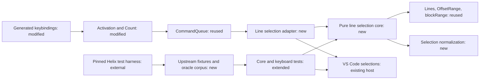

# Select Line Specification

## Intent and Delivery Scope

The user requested Helix `x` and `X` bindings, full feature parity, and replication of the upstream tests.
The user also requested an independent Claude Code review.
The supplied conversation reports that review as complete and supports a direct TypeScript port.
Its transcript is unavailable in this checkout; this specification does not claim a new Claude review.

The user then requested an implementation plan and invoked quickie to generate both artifacts on autopilot.
This invocation delegates routine design and planning approvals. It does not authorize implementation during this run.

The outcome is exact line-selection behavior against pinned Helix, including counts and selection-set normalization.
The target revision is `ba40e547426b0f9896c8bdc699a4ab11f2b37dbc`.
Parity compares document content, directed ranges, and primary identity after each command.
Offsets must map between Helix character indices and VS Code UTF-16 indices.

The reviewed approach requires `editor.multiCursorMergeOverlapping=false` for exact host behavior.
This is an explicit environment prerequisite, carried into this design from the reviewed recommendation.
The extension must not change that setting automatically.
Default-setting operation cannot claim full parity for the EOF cursor case.
Documentation must state that limitation before setup and acceptance instructions.

Includes:

- NORMAL-mode `x` and `X`, with selection-only behavior in writable and read-only text editors.
- Existing count integration required to execute upstream sequences.
- Helix line boundaries, direction, grapheme handling, normalization, and primary preservation.
- Upstream fixtures, supporting selection tests, independent oracle cases, and real keyboard verification.
- Compatibility documentation and regression checks for existing editor behavior.

## Evidence and Provenance

Repository inspection occurred on 2026-10-24. The working tree was clean before artifact creation.
No `AGENTS.md` file was found in this checkout or its ancestor path.

| Repository fact | Evidence |
|---|---|
| Activation registers word motions, edits, history, modes, and word jumps | `src/extension.ts:activate` |
| Motion registration requires a `Count` argument | `src/core/registerMotion.ts:registerMotion` |
| Activation omits required count arguments in three calls | `src/extension.ts:activate` |
| An integration caller also omits the count argument | `test/integration/index.ts:run` |
| Counts exist but lack activation and digit bindings | `src/core/count.ts:Count`; `scripts/keybindings.cjs:createKeybindings` |
| Empty carets can become grapheme block ranges | `src/core/editing.ts:blockRange` |
| Existing line access uses UTF-16 offsets | `src/core/charMotion.ts:Lines`, `textLines` |
| Motions and edits already use offset ranges | `src/core/wordMotion.ts:OffsetRange`; `src/vscode/editing.ts` |
| Edits, undo, and mode commands share a command queue | `src/vscode/queue.ts:CommandQueue`; `src/extension.ts:activate` |
| Keybindings are generated and checked | `scripts/keybindings.cjs`; `test/unit/keybindings.test.ts` |
| Existing fixture parsing lacks upstream newline skipping | `test/unit/helix.ts:parse` |
| Keyboard sequences currently lack digit support | `test/integration/keyboard.ts:Keyboard.keys` |
| Host tests use an isolated profile and real keyboard events | `test/runIntegration.ts`; `test/integration/keyboard.ts` |

External primary sources were retrieved on 2026-10-24:

- [Default mappings](https://github.com/helix-editor/helix/blob/ba40e547426b0f9896c8bdc699a4ab11f2b37dbc/helix-term/src/keymap/default.rs#L99): `x` invokes `extend_line_below`; `X` invokes `extend_to_line_bounds`.
- [Command algorithms](https://github.com/helix-editor/helix/blob/ba40e547426b0f9896c8bdc699a4ab11f2b37dbc/helix-term/src/commands.rs#L2813): `extend_line_impl` and `extend_to_line_bounds` define the transformations.
- [Selection rules and tests](https://github.com/helix-editor/helix/blob/ba40e547426b0f9896c8bdc699a4ab11f2b37dbc/helix-core/src/selection.rs): `line_range`, `overlaps`, `merge`, `normalize`, and `ensure_invariants` define supporting behavior.
- [Command tests](https://github.com/helix-editor/helix/blob/ba40e547426b0f9896c8bdc699a4ab11f2b37dbc/helix-term/tests/test/commands.rs#L324): `test_extend_line` contains `x2x` and `2x`.
- [Fixture parser](https://github.com/helix-editor/helix/blob/ba40e547426b0f9896c8bdc699a4ab11f2b37dbc/helix-core/src/test.rs#L36): `print` parses notation and skips duplicated display newlines.
- [Count handling](https://github.com/helix-editor/helix/blob/ba40e547426b0f9896c8bdc699a4ab11f2b37dbc/helix-term/src/ui/editor.rs#L1014): digit accumulation stops above `100_000_000`.
- [Oracle harness](https://github.com/helix-editor/helix/blob/ba40e547426b0f9896c8bdc699a4ab11f2b37dbc/helix-term/tests/test/helpers.rs): `test_key_sequence_with_input_text` permits inspection of real Helix results.
- [VS Code cursor normalization](https://github.com/microsoft/vscode/blob/d48550294e1b2002420f00dd92a235d3b02e62f1/src/vs/editor/common/cursor/cursorCollection.ts#L188): the default merges touching ranges when either range is empty.

The conversation reports a VS Code 1.142.0 reproduction of the EOF limitation.
This run verified the source rule but did not repeat that host experiment.
The conversation also reports four compile errors and 56 separately passing unit tests.
Static inspection confirms four missing count arguments. This run did not execute compilation or tests.

## Functional Requirements

- **FR-1** — `x` must match pinned Helix `extend_line_below` for each input range.
  - Selection: included
  - Source: user parity request; command algorithms.
  - UI: UI-1
  - Verification: Compare directed ranges for partial selections, full lines, repeated input, counts, blank lines, and EOF variants.

- **FR-2** — `X` must match pinned Helix `extend_to_line_bounds` for each input range.
  - Selection: included
  - Source: user parity request; command algorithms.
  - UI: UI-1
  - Verification: Compare forward and reversed ranges; repeated `X` must be idempotent. A count must be consumed without changing expansion.

- **FR-3** — Count prefixes must reach `x` and clear at the next command or cancellation boundary.
  - Selection: included
  - Source: necessary inference from upstream `x2x` and `2x`; existing `Count` contract.
  - Recommendation: Recommended mandatory
  - Reason: Without digit input and lifecycle wiring, the required upstream sequences cannot execute.
  - UI: UI-1
  - Verification: Replay multi-digit counts, leading zero, overflow, `2Xx`, `2<esc>x`, ignored input, word-jump entry, mode changes, and editor switches.
  - Verification: Existing count-aware word and history commands must retain their declared count behavior after activation wiring.

- **FR-4** — Each command must normalize the complete selection set according to pinned Helix and preserve primary identity.
  - Selection: included
  - Source: necessary inference from parity; selection rules.
  - Recommendation: Recommended mandatory
  - Reason: Independent range mapping cannot produce the required multi-selection result.
  - Verification: Compare sorted overlaps, duplicates, mixed directions, touching ranges, and EOF points against upstream cases and oracle results.

- **FR-5** — Bindings must follow the existing editor, mode, suspension, and word-jump rules.
  - Selection: included
  - Source: necessary inference from feature integration; generated bindings and existing motion behavior.
  - Recommendation: Recommended mandatory
  - Reason: Unguarded bindings would capture text input outside NORMAL mode.
  - UI: UI-1
  - Verification: Real keyboard tests cover writable and read-only editors, INSERT, suspension, Quick Input, label input, and user binding precedence.

- **FR-6** — Tests must replicate all pinned upstream cases directly relevant to these commands and their selection rules.
  - Selection: included
  - Source: explicit user request to replicate the Helix test suite for this feature.
  - Verification: Inventory both `test_extend_line` cases and supporting cases without skips or changed expected results.
  - Verification: Cover `test_line_range`, `test_overlaps`, `test_create_normalizes_and_merges`, and `test_create_merges_adjacent_points`.

- **FR-7** — Additional parity cases must use expected results produced by pinned Helix independently of the TypeScript port.
  - Selection: included
  - Source: necessary inference from full parity and the absence of dedicated upstream `X` tests.
  - Recommendation: Recommended mandatory
  - Reason: Two count tests cannot establish the requested behavior across the identified boundaries.
  - Verification: Replay the oracle matrix in the pure core and representative cases in VS Code, including follow-on edits and undo.

## Non-Functional Requirements

- **NFR-1** (architecture) — The extension must use a pure TypeScript core with a small VS Code adapter and existing runtime dependencies.
  - Selection: included
  - Source: reviewed strategy; existing core and adapter structure.
  - Recommendation: Recommended mandatory
  - Reason: This structure permits direct upstream tests without embedding another editor runtime.
  - Verification: Node tests import the core without `vscode`; dependency review finds no added runtime dependency.

- **NFR-2** (compatibility) — Exact parity acceptance must require the compatibility setting and must not change user settings automatically.
  - Selection: included
  - Source: reviewed prerequisite; existing extension policy of preserving user settings.
  - Recommendation: Recommended mandatory
  - Reason: VS Code otherwise removes a valid Helix EOF cursor before subsequent commands can observe it.
  - Verification: Compatible profiles preserve the EOF pair. Default profiles demonstrate the documented limitation. Configuration values remain unchanged.

- **NFR-3** (regression) — Existing unit and integration checks must pass after the necessary count wiring is completed.
  - Selection: included
  - Source: necessary inference from adding a feature to the existing extension.
  - Recommendation: Recommended mandatory
  - Reason: Selection-only commands must not break existing typing, edits, history, or generated bindings.
  - Verification: `npm test` and `npm run test:integration` pass. Line commands do not change text, dirty state, or undo history.

## Excluded and Deferred Requirements

- A logical-selection subsystem, custom rendering, and edit routing are excluded from this delivery.
  - Source: alternative from exploration; selection: excluded; recommendation: Optional.
  - Reason: The reviewed compatibility prerequisite permits the smaller direct-port approach.
  - Consequence: Full parity under default cursor-merging settings remains unsupported.
- New SELECT mode, `Alt-x`, other line commands, and activation of unused `hjkl` modules are excluded.
  - Source: adjacent features; selection: excluded; recommendation: Optional.
  - Reason: They are unnecessary for the requested commands in the extension's existing modes.
- Continuous upstream synchronization and a general Helix conformance framework are deferred.
  - Source: optional maintenance work; selection: deferred; recommendation: Optional.
  - Reason: A pinned, reproducible oracle is sufficient for this delivery.
- Repairs unrelated to count integration or failed line-selection acceptance remain excluded.

## Framed Ledger

| Category | Status | Decision or section reference | Open issue or omission reason |
|---|---|---|---|
| UI | approved | UI-1 | None; quickie delegation |
| Architecture (HLD) | approved | Architecture (HLD) | None; quickie delegation |
| Models | drafted | Models | None; final checks complete |
| Contracts | drafted | Contracts | None; final checks complete |
| Functions | drafted | Functions | None; final checks complete |
| Interfaces or Classes | drafted | Interfaces or Classes | Existing contracts reused; no new class required |
| Behavior | drafted | Behavior | None; final checks complete |
| Failure Model | drafted | Failure Model | None; final checks complete |
| Traceability | drafted | Traceability | All included requirements covered |

### Approval Records

- **Scope** — Include the supplied feature and necessary count, normalization, and parity checks.
  - Evidence: User requested the reviewed plan, then said, “use quickie to generate specs and implementation plan on autopilot”.
  - Date: 2026-10-24.
  - Delegation: Routine scope decisions only; preserve full parity and the reviewed compatibility prerequisite.
  - Validity: current.
- **UI** — Approve UI-1 under the same quickie invocation.
  - Delegation: Existing keyboard interactions only; no new screen or settings write.
  - Validity: current; delegated approval, not direct user review.
- **HLD** — Approve the direct port, whole-set normalization, shared queue, and existing count ownership.
  - Evidence: Reviewed recommendation and quickie invocation on 2026-10-24.
  - Delegation: Routine architecture details within that approach; no new runtime or logical-selection subsystem.
  - Validity: current; delegated approval, not direct user review.
- **Final specification** — Validation completed under quickie delegation on 2026-10-24.
  - Checks: Requirements, ledger, contracts, behavior, failures, exclusions, evidence, and traceability agree.
  - Limits: This approves documentation only. It does not claim implemented or experimentally proven parity.
  - Validity: current; delegated approval, not direct user review.

## UI

### UI-1 — Editor Keyboard Controls

Requirements: FR-1, FR-2, FR-3, FR-5, NFR-2.

| Context | Input | Visible result |
|---|---|---|
| Enabled NORMAL editor | `x` | Whole logical lines selected; repeat extends downward |
| Enabled NORMAL editor | `Shift+x` | Whole logical lines selected; direction preserved |
| Enabled NORMAL editor | `2x` | Counted line expansion |
| Enabled NORMAL editor | `2Xx` | `X` consumes the count; following `x` uses one |
| Active word jump | `x` | Existing label-input behavior |
| Active word jump | `Shift+x` or digit | Existing cancellation behavior |
| INSERT or suspended editor | `x`, `X`, digits | Native input |
| Quick Input | `x`, `X`, digits | Native text input |

Inline wireframe: `NORMAL → 2 → x → [line 1\nline 2\n]`.
Empty documents retain their EOF point. Read-only documents permit selection changes.
No loading, network, or new access state exists. Native selection rendering handles narrow editors and accessibility.
Command titles expose the actions through the Command Palette.

## Architecture (HLD)

### Architecture Decisions

- Port pinned Helix algorithms directly; do not delegate line semantics to VS Code `expandLineSelection`.
- Reuse `OffsetRange`, `Lines`, `WordMotionText`, `blockRange`, `Count`, and `CommandQueue`.
- Add a whole-set line-selection adapter because `registerMotion` only maps individual selections.
- Keep VS Code selections authoritative. Require the compatibility setting for exact parity.
- Capture and clear counts at command dispatch. Queue line-selection work with edits, modes, and history.
- Keep upstream fixture parsing separate from the current round-trip parser.
- Use real Helix only for test-data generation. Do not ship Rust, WASM, or a Helix process.

### Components

- **Activation and counts — modified:** `src/extension.ts:activate`; `src/core/count.ts:Count`.
  Own one count instance and register count-aware commands. Preserve existing command behavior.
- **Binding generator — modified:** `scripts/keybindings.cjs:createKeybindings`.
  Own default bindings and preserve user overrides and word-jump precedence.
- **Pure line-selection core — new:** `src/core/lineSelection.ts`.
  Own line transforms and whole-set normalization. Import no VS Code API.
- **Line adapter — new:** `src/motions/line.ts`.
  Own host conversion, command guards, queued execution, selection assignment, and reveal.
- **Shared queue — unchanged:** `src/vscode/queue.ts:CommandQueue`.
  Serialize commands so a line selection observes the completed preceding edit.
- **Test support — new and modified:** dedicated upstream importer, oracle fixtures, and existing keyboard harness.
  Own independent expected values and replay. Do not derive expected values from the port.

### Architectural Flow

The keybinding dispatches a registered command. That command snapshots and clears the pending count.
The shared queue waits for earlier editor actions.
The adapter checks the current editor and mode, reads selections, and maps UTF-16 positions.
It establishes Helix block-selection invariants, applies the line transform, and normalizes the complete set.
It writes the primary range first and reveals it. Document content and undo history remain unchanged.

The editor API is the host boundary. Oracle output is test input and must pass schema and offset validation.
No production network access, persistence, deployment change, or new package is required.

## Models

- Reuse `OffsetRange` from `src/core/wordMotion.ts`: `anchor` and `head` are UTF-16 gap offsets.
- Reuse `Lines` from `src/core/charMotion.ts`: each line exposes `start`, content `end`, and text.
- A complete selection set contains at least one range and a primary identity.
  The adapter representation is primary-first. The core may use sorted ranges and an explicit primary index.
- Normalized ranges are grapheme aligned and bounded by the document.
  Non-EOF carets become blocks before command evaluation. EOF points may remain empty.
- Sorting and merging must retain the primary range or its merged replacement.
- Oracle cases record revision, source or case identifier, input text, input selections, keys, output text, and output selections.
  Record coordinate units and primary identity explicitly. Convert Helix character indices to UTF-16 without changing text.

## Contracts

### Command and Binding Contract

New commands are `miniHelix.extendLineBelow` and `miniHelix.extendToLineBounds`.
Their default keys are `x` and `shift+x`.
Contribute titles and register both during activation.
Use existing motion contexts, including `editorTextFocus` and `!miniHelix.wordJumpActive`.
Do not require writable documents. Keep word-jump capture entries later than ordinary bindings.

Internal digit dispatch uses `miniHelix.countDigit` with an integer argument from zero through nine.
Bind top-row and numeric-keypad digits in idle NORMAL editors.
Unshifted digits start or continue counts; shifted symbols retain existing behavior.
Reject invalid programmatic digit arguments without changing pending state.
Do not add a public count context or API field.

### Selection Contract

For nonempty ranges, `line_range` finds the final covered line from the grapheme before the upper endpoint.
An empty range uses its own position for both line indices.
Line boundaries include the full line ending when present.
LF, CRLF, CR, missing final newline, and a final empty line must use the same document interpretation as pinned Helix.

Overlaps merge according to Helix `Range::overlaps`; touching ranges remain separate unless that predicate requires merging.
A point at a range's end remains separate. A point at its start merges.
A merged range remains reversed only when both merged ranges are reversed.
Track primary identity through sorting, duplicate removal, and transitive merges.

### Fixture and Oracle Contract

Use a dedicated upstream notation importer rather than changing `test/unit/helix.ts:parse` semantics.
Match `helix_core::test::print`, including LF and CRLF display-newline skipping.
Retain existing fixture round trips and expected values.
Record upstream paths, names, revision, and required license attribution beside imported cases.
The oracle corpus must include deterministic regeneration instructions through the pinned integration harness.
Ordinary extension tests must run without Rust, network access, or Helix installed.

## Functions

- **Pure transform responsibility:** Accept line access, grapheme access, ranges, primary identity, command kind, and count.
  Return normalized directed ranges with primary identity. Do not mutate input or editor state.
- **Line adapter responsibility:** Reuse document line access and offset conversion; register both commands against the shared count and queue.
  Ignore no-editor, INSERT, and suspended invocations without text changes.
- **Count integration responsibility:** Supply the existing required arguments and connect guarded digit input.
  Clear pending counts on other extension commands, ignored NORMAL input, Escape, mode changes, suspension, and editor changes.
  Preserve existing count-aware word-motion and history semantics. Do not add new count semantics to unrelated edits.
- **Test importer responsibility:** Return document text and directed ranges with primary identity from upstream notation.
  Reject malformed notation and invalid oracle records with useful test failures.

## Interfaces or Classes

Reuse existing `Count`, `CommandQueue`, `Lines`, `OffsetRange`, and mode interfaces.
The core must expose a callable transform for Node tests and the host adapter.
Keep exact private helper signatures and class decomposition at implementation discretion.
No new public extension API or persistent format is required.

## Behavior

### `x`

1. Establish Helix range invariants before checking whole-line coverage.
2. Compute the first and last covered logical lines with `line_range`.
3. Expand from the first line start through the last covered line ending.
4. When the range already covers those complete lines, extend below by the count.
5. Otherwise, include the initial expansion as the first count step.
6. Clamp the endpoint at EOF and produce forward ranges.
7. Normalize the full selection set and preserve primary identity.

A caret on a blank line covers its newline before step three.
That block already covers the line, so `x` extends beyond it when another line exists.

### `X`

1. Establish the same input invariants and covered line range.
2. Expand to those line boundaries and preserve the original direction.
3. Ignore the consumed count for expansion.
4. Normalize the complete set and preserve primary identity.

Repeated `X` preserves the result.
Commands operate on logical lines even when the editor wraps text visually.

### Counts and Ordered Commands

Leading zero does nothing without a pending count.
Digits continue pending counts up to the existing `MAX_COUNT` rule.
Snapshot a command's count before asynchronous work permits later input.
Escape in NORMAL must clear a pending count.
Word-jump input retains its existing precedence and does not reuse a stale count.
Queued `dx`, `xd`, `xc`, `xdu`, and `xc<esc>u` must observe each preceding action's completed state.

## Failure Model

- **F-1 — Host merges an EOF point.**
  - Detector: Integration replay under the default cursor-merging setting.
  - Response: Document the unsupported exact-parity configuration; never claim that the missing point survived.
  - Verification: Paired default and compatible profiles demonstrate the difference without changing user settings.
- **F-2 — Count survives cancellation or mode changes.**
  - Detector: Cancellation and rapid-input tests.
  - Response: Clear count ownership at the declared lifecycle boundaries.
  - Verification: The next `x` uses one after each reset boundary.
- **F-3 — Command runs without an eligible editor.**
  - Detector: Adapter guards.
  - Response: Consume pending command state and return without editing or throwing.
  - Verification: Command invocation without an editor, in INSERT, or while suspended leaves text unchanged.
- **F-4 — Oracle data or imported notation is invalid.**
  - Detector: Fixture validation and parser errors.
  - Response: Fail tests with the source case identifier. Never substitute port-generated expected values.
  - Verification: Invalid records fail; all imported upstream cases run without skips.
- **F-5 — Source or host differs from the pinned assumptions.**
  - Detector: Revision checks, source hashes, and supported-host replay.
  - Response: Stop parity acceptance and review the affected source or compatibility claim.
  - Verification: Regeneration rejects a different Helix revision; host failures remain visible.

## Traceability

| Requirement | Design coverage | Observable verification |
|---|---|---|
| FR-1 | Pure core; `x` behavior; UI-1 | Upstream count cases and oracle `x` matrix |
| FR-2 | Pure core; `X` behavior; UI-1 | Direction, count consumption, repeated `X` |
| FR-3 | Count integration; ordered commands; UI-1 | Prefix, reset, overflow, rapid input, existing consumers |
| FR-4 | Selection contract; core normalization | Upstream selection tests, primary and EOF cases |
| FR-5 | Command contract; adapter guards; UI-1 | Keyboard context and override tests |
| FR-6 | Dedicated importer; fixture contract | Named upstream inventory without skips |
| FR-7 | Oracle contract; host replay | Independent expected results and follow-on actions |
| NFR-1 | Architecture and reusable models | Core runs in Node; runtime dependency review |
| NFR-2 | Compatibility prerequisite; F-1 | Both host configurations; unchanged settings |
| NFR-3 | Shared queue; existing components | Full unit and integration suites; unchanged document state |

## Open Issues

None that block implementation planning.
Implementation must demonstrate parity through the specified checks before claiming delivery.
Default cursor-merging settings retain the explicit, accepted planning limitation described above.
